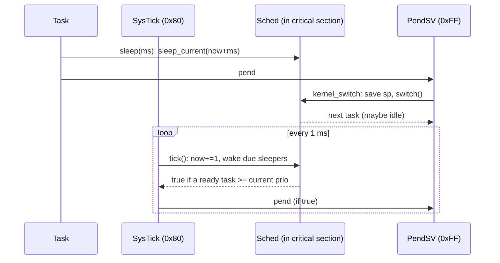

# M2: Preemptive Priority Scheduler, Tick, Sleep, Idle — Implementation Plan

> **For agentic workers:** REQUIRED SUB-SKILL: Use superpowers:subagent-driven-development (recommended) or superpowers:executing-plans to implement this plan task-by-task. Steps use checkbox (`- [ ]`) syntax for tracking.
>
> **Ownership:** Tasks 1 and 5 are Claude's (plumbing, tests, demo, review). Tasks 2–4 are the **user's** (kernel core): an agent MUST NOT write `kernel/src/sched.rs`, the non-test parts of `kernel/src/task.rs`, or `kernel/src/arch/mod.rs` unless the user asks; it may explain and review.

**Goal:** The most urgent ready task always runs; a 1 kHz SysTick preempts, time-slices equal priorities and wakes sleepers; `sleep`/`sleep_until`/`now` work; an idle task runs `wfi` when nothing else is ready.

**Architecture:** `sched.rs` holds all scheduling state in one `Sched` value (ready lists + priority bitmap, sorted sleep list, current task, tick count) as pure, host-tested logic. `arch/mod.rs` owns the single `static mut SCHED`, guards every access with a critical section, and wires it to SysTick, PendSV (unchanged from M1) and the public API.

**Tech Stack:** M1 kernel; `cortex-m` 0.7 (`SYST`, `SCB`, `interrupt::free`).

**Spec:** `docs/superpowers/specs/2026-10-14-rtos-kernel-design.md` (section 3, milestone M2)

## Global Constraints

- Everything in the M0/M1 plans' Global Constraints still holds.
- 8 priorities (`PRIOS = 8`), higher = more urgent. 0 is the kernel's idle task; `Task::new` accepts 1..=7 only.
- Tick = 1 ms (SysTick at `sys_hz / 1000`), `u64`, never wraps.
- The running task is in **no** list; `Sched::current()` points at it.
- Every `Sched` access on target happens inside `cortex_m::interrupt::free` (SysTick, priority `0x80`, can interrupt PendSV, `0xFF`, and tasks).
- Tests MUST NOT use `Box::leak`; test tasks are owned and freed (see `sched/tests.rs`).
- Verified on this board with a throwaway reference (2026-10-14): all host tests, `m2_sleep`, `m2_preempt`, `m1_coop`, `m1_overflow` pass; `m2_preempt` and the host tests fail against a scheduler without round-robin.

## Fixed interfaces

```rust
// kernel/src/task.rs
#[derive(Clone, Copy, PartialEq, Debug)]
pub(crate) enum State { Ready, Running, Sleeping }
pub struct Task {
    pub(crate) sp: *mut u32,
    pub(crate) stack_limit: *mut u32,
    pub(crate) state: State,
    pub(crate) prio: u8,
    pub(crate) wake: u64,     // tick to wake at while Sleeping
    pub(crate) next: *mut Task, // link in whichever list the task is in
    name: &'static str,
}
impl Task {
    pub fn new<const N: usize>(name: &'static str, prio: u8, entry: fn() -> !, stack: &'static Stack<N>) -> Task; // asserts 1..=7
    pub(crate) fn idle<const N: usize>(entry: fn() -> !, stack: &'static Stack<N>) -> Task; // prio 0, name "idle"; kernel only
    #[cfg(test)] pub(crate) fn for_test(prio: u8) -> Task; // stackless, Claude writes it
}

// kernel/src/sched.rs
pub(crate) const PRIOS: usize = 8;
pub(crate) struct Sched { /* .. */ }
impl Sched {
    pub(crate) const fn new() -> Self;
    pub(crate) fn now(&self) -> u64;
    pub(crate) fn current(&self) -> *mut Task;              // null before the first switch
    pub(crate) unsafe fn make_ready(&mut self, t: *mut Task); // state = Ready, tail of its priority list
    pub(crate) fn switch(&mut self) -> *mut Task;          // requeue current if Running, run the head of the highest list
    pub(crate) fn sleep_current(&mut self, until: u64) -> bool; // false (no-op) if until <= now
    pub(crate) fn tick(&mut self) -> bool;                 // now += 1, wake due sleepers; true = switch needed
}

// kernel/src/arch/mod.rs (Arm only), re-exported from lib.rs
pub fn start(tasks: &mut [Task], sys_hz: u32) -> !;
pub fn yield_now();
pub fn now() -> u64;
pub fn sleep(ms: u32);
pub fn sleep_until(tick: u64);
```

## How the pieces interact



---

### Task 1 (Claude): M2 harness

**Files:**
- Modify: `kernel/src/lib.rs`, `kernel/src/task/tests.rs`, `kernel/src/task.rs` (append the `#[cfg(test)]` `for_test` block only), `app/src/lib.rs`, `app/src/bin/m1_coop.rs`, `app/src/bin/m1_overflow.rs`, `app/src/bin/m1_blinky.rs`
- Create: `kernel/src/sched/tests.rs`, `app/src/bin/m2_sleep.rs`, `app/src/bin/m2_preempt.rs`

**Interfaces:** Produces the expectations above; red until Tasks 2–4 land.

- [ ] **Step 1: `kernel/src/lib.rs`**

```rust
//! ros kernel. Pure logic is host-testable; `arch` is Cortex-M33 only.
#![cfg_attr(not(test), no_std)]

mod sched;
mod task;
pub use task::{Stack, Task};

#[cfg(target_arch = "arm")]
mod arch;
#[cfg(target_arch = "arm")]
pub use arch::{now, sleep, sleep_until, start, yield_now};
```

- [ ] **Step 2: `Task::for_test` (append to `kernel/src/task.rs`, before the constants)**

```rust
#[cfg(test)]
impl Task {
    /// Stackless task for scheduler tests: only the fields `Sched` reads are meaningful.
    pub(crate) fn for_test(prio: u8) -> Task {
        Task {
            sp: core::ptr::null_mut(),
            stack_limit: core::ptr::null_mut(),
            state: State::Ready,
            prio,
            wake: 0,
            next: core::ptr::null_mut(),
            name: "t",
        }
    }
}
```

- [ ] **Step 3: `kernel/src/task/tests.rs`**: `Task::new("t", never, &STACK)` → `Task::new("t", 1, never, &STACK)`.

- [ ] **Step 4: `kernel/src/sched/tests.rs`**

```rust
//! Host tests for the scheduler. Run: `cargo ktest`.
use super::*;

/// Owns the test tasks; frees them when the test ends. The scheduler only ever
/// sees raw pointers, so they must come from `Box::into_raw` (not `&mut`).
struct Tasks(Vec<*mut Task>);

impl Drop for Tasks {
    fn drop(&mut self) {
        for &t in &self.0 {
            drop(unsafe { Box::from_raw(t) });
        }
    }
}

/// Scheduler with `prios` made ready in order, then an idle task (prio 0).
/// Returns (sched, idle, tasks in `prios` order, owner).
fn sched_with(prios: &[u8]) -> (Sched, *mut Task, Vec<*mut Task>, Tasks) {
    let new = |p| Box::into_raw(Box::new(Task::for_test(p)));
    let ts: Vec<_> = prios.iter().map(|&p| new(p)).collect();
    let idle = new(0);
    let mut s = Sched::new();
    unsafe {
        for &t in &ts {
            s.make_ready(t);
        }
        s.make_ready(idle);
    }
    let mut all = ts.clone();
    all.push(idle);
    (s, idle, ts, Tasks(all))
}

#[test]
fn picks_highest_priority_ready_task() {
    let (mut s, _, t, _own) = sched_with(&[1, 3, 2]);
    assert_eq!(s.switch(), t[1]);
}

#[test]
fn higher_priority_keeps_cpu_over_lower() {
    let (mut s, _, t, _own) = sched_with(&[1, 3]);
    assert_eq!(s.switch(), t[1]);
    assert_eq!(s.switch(), t[1], "yielding to a lower priority task");
}

#[test]
fn equal_priorities_take_turns_in_fifo_order() {
    let (mut s, _, t, _own) = sched_with(&[2, 2, 2]);
    let order: Vec<_> = (0..6).map(|_| s.switch()).collect();
    assert_eq!(order, [t[0], t[1], t[2], t[0], t[1], t[2]]);
}

#[test]
fn idle_runs_when_every_task_sleeps() {
    let (mut s, idle, t, _own) = sched_with(&[1]);
    assert_eq!(s.switch(), t[0]);
    assert!(s.sleep_current(5));
    assert_eq!(s.switch(), idle);
}

#[test]
fn sleep_until_now_or_past_does_not_sleep() {
    let (mut s, _, t, _own) = sched_with(&[1]);
    s.switch();
    s.tick();
    s.tick();
    assert!(!s.sleep_current(2), "deadline == now");
    assert!(!s.sleep_current(1), "deadline in the past");
    assert_eq!(s.switch(), t[0], "task should still be runnable");
}

#[test]
fn sleeper_wakes_on_its_tick_and_not_before() {
    let (mut s, idle, t, _own) = sched_with(&[1]);
    s.switch();
    s.sleep_current(3);
    assert_eq!(s.switch(), idle);
    assert!(!s.tick(), "tick 1: nothing woke");
    assert!(!s.tick(), "tick 2: nothing woke");
    assert!(s.tick(), "tick 3: task woke and outranks idle");
    assert_eq!(s.now(), 3);
    assert_eq!(s.switch(), t[0]);
}

#[test]
fn sleepers_wake_by_deadline_then_fifo_on_ties() {
    let (mut s, idle, t, _own) = sched_with(&[1, 1, 1]);
    assert_eq!(s.switch(), t[0]);
    s.sleep_current(5);
    assert_eq!(s.switch(), t[1]);
    s.sleep_current(3);
    assert_eq!(s.switch(), t[2]);
    s.sleep_current(5);
    assert_eq!(s.switch(), idle);
    for _ in 0..5 {
        s.tick();
    }
    let order: Vec<_> = (0..3).map(|_| s.switch()).collect();
    assert_eq!(order, [t[1], t[0], t[2]]);
}

#[test]
fn tick_requests_switch_only_for_an_equal_or_higher_peer() {
    let (mut s, _, _, _own) = sched_with(&[2, 2]);
    s.switch();
    assert!(s.tick(), "same-priority peer ready: time slice is up");

    let (mut s, _, _, _own) = sched_with(&[2]);
    s.switch();
    assert!(!s.tick(), "only idle (lower) is ready");
}

#[test]
fn tick_requests_preemption_when_higher_task_wakes() {
    let (mut s, _, t, _own) = sched_with(&[3, 1]);
    assert_eq!(s.switch(), t[0]);
    s.sleep_current(2);
    assert_eq!(s.switch(), t[1]);
    assert!(!s.tick());
    assert!(s.tick(), "high task woke above the running one");
    assert_eq!(s.switch(), t[0]);
}

#[test]
fn task_woken_before_its_switch_is_not_queued_twice() {
    // Race: a task calls sleep, but SysTick wakes it before PendSV runs.
    let (mut s, idle, t, _own) = sched_with(&[1]);
    assert_eq!(s.switch(), t[0]);
    s.sleep_current(1);
    s.tick(); // wakes t[0] while it is still `current`
    assert_eq!(s.switch(), t[0]);
    s.sleep_current(10);
    assert_eq!(s.switch(), idle, "a stale second queue entry ran a sleeping task");
}

#[test]
fn tick_before_start_requests_nothing() {
    let (mut s, _, _, _own) = sched_with(&[1]);
    assert!(!s.tick());
}
```

- [ ] **Step 5: `app/src/lib.rs`**: `Board` gains `sys_hz` (from the HAL clocks):

```rust
//! Board support shared by every demo binary.
#![no_std]

use hal::Clock;
use rp235x_hal as hal;
use {defmt_rtt as _, panic_probe as _};

pub use hal::entry;

/// Tells the RP2350 boot ROM this is a Secure Arm executable.
#[unsafe(link_section = ".start_block")]
#[used]
pub static IMAGE_DEF: hal::block::ImageDef = hal::block::ImageDef::secure_exe();

/// Pico 2 W crystal.
pub const XTAL_FREQ_HZ: u32 = 12_000_000;

pub struct Board {
    pub pins: hal::gpio::Pins,
    pub timer: hal::Timer<hal::timer::CopyableTimer0>,
    /// Core clock in Hz (150 MHz); `kernel::start` derives the 1 kHz tick from it.
    pub sys_hz: u32,
}

/// Clocks to 150 MHz, GPIO bank, TIMER0.
pub fn init() -> Board {
    let mut pac = hal::pac::Peripherals::take().unwrap();
    let mut watchdog = hal::Watchdog::new(pac.WATCHDOG);
    let clocks = hal::clocks::init_clocks_and_plls(
        XTAL_FREQ_HZ,
        pac.XOSC,
        pac.CLOCKS,
        pac.PLL_SYS,
        pac.PLL_USB,
        &mut pac.RESETS,
        &mut watchdog,
    )
    .unwrap();
    let timer = hal::Timer::new_timer0(pac.TIMER0, &mut pac.RESETS, &clocks);
    let sio = hal::Sio::new(pac.SIO);
    let pins = hal::gpio::Pins::new(pac.IO_BANK0, pac.PADS_BANK0, sio.gpio_bank0, &mut pac.RESETS);
    Board { pins, timer, sys_hz: clocks.system_clock.freq().to_Hz() }
}

/// End a test binary successfully: `probe-rs run` exits 0.
pub fn exit_ok() -> ! {
    defmt::info!("TEST PASS");
    cortex_m_semihosting::debug::exit(cortex_m_semihosting::debug::EXIT_SUCCESS);
    unreachable!()
}
```

- [ ] **Step 6: M1 binaries.** `Task::new(name, 1, entry, &STACK)` and `kernel::start(&mut tasks, b.sys_hz)` in `m1_coop`, `m1_overflow`, `m1_blinky`. In `m1_coop`, a tick may now switch tasks mid-round, so each task *waits* for its turn instead of asserting it; full file:

```rust
//! M1: two tasks alternate via `yield_now`; the context switch preserves
//! callee-saved FP registers (s16-s31) that only PendSV can save. Since M2 a
//! tick can also switch tasks, so each task waits for its turn instead of
//! asserting it already has it.
#![no_std]
#![no_main]

use core::arch::asm;
use core::sync::atomic::{AtomicU32, Ordering::SeqCst};
use kernel::{Stack, Task};

const ROUNDS: u32 = 5;
static TURN: AtomicU32 = AtomicU32::new(0);
static STACK_A: Stack<512> = Stack::new();
static STACK_B: Stack<512> = Stack::new();

/// Fills s16-s31 with `seed, seed+1, ..`, pends PendSV *inside the same asm
/// block* (so the compiler cannot spill them for us), then checks they still
/// hold the pattern. The other task does the same with a different seed, so a
/// switch that skips s16-s31 hands us its values and this returns false.
fn fp_regs_survive_switch(seed: u32) -> bool {
    let bad: u32;
    unsafe {
        asm!(
        "mov {bad}, #0",
        "vmov s16, {s}",
        "add {s}, {s}, #1",
        "vmov s17, {s}",
        "add {s}, {s}, #1",
        "vmov s18, {s}",
        "add {s}, {s}, #1",
        "vmov s19, {s}",
        "add {s}, {s}, #1",
        "vmov s20, {s}",
        "add {s}, {s}, #1",
        "vmov s21, {s}",
        "add {s}, {s}, #1",
        "vmov s22, {s}",
        "add {s}, {s}, #1",
        "vmov s23, {s}",
        "add {s}, {s}, #1",
        "vmov s24, {s}",
        "add {s}, {s}, #1",
        "vmov s25, {s}",
        "add {s}, {s}, #1",
        "vmov s26, {s}",
        "add {s}, {s}, #1",
        "vmov s27, {s}",
        "add {s}, {s}, #1",
        "vmov s28, {s}",
        "add {s}, {s}, #1",
        "vmov s29, {s}",
        "add {s}, {s}, #1",
        "vmov s30, {s}",
        "add {s}, {s}, #1",
        "vmov s31, {s}",
        "add {s}, {s}, #1",
        "movw {t}, #0xED04", // ICSR
        "movt {t}, #0xE000",
        "mov {u}, #0x10000000", // PENDSVSET
        "str {u}, [{t}]",
        "dsb",
        "isb", // PendSV taken here; other task runs
        "sub {s}, {s}, #16",
        "vmov {u}, s16",
        "eor {u}, {u}, {s}",
        "orr {bad}, {bad}, {u}",
        "add {s}, {s}, #1",
        "vmov {u}, s17",
        "eor {u}, {u}, {s}",
        "orr {bad}, {bad}, {u}",
        "add {s}, {s}, #1",
        "vmov {u}, s18",
        "eor {u}, {u}, {s}",
        "orr {bad}, {bad}, {u}",
        "add {s}, {s}, #1",
        "vmov {u}, s19",
        "eor {u}, {u}, {s}",
        "orr {bad}, {bad}, {u}",
        "add {s}, {s}, #1",
        "vmov {u}, s20",
        "eor {u}, {u}, {s}",
        "orr {bad}, {bad}, {u}",
        "add {s}, {s}, #1",
        "vmov {u}, s21",
        "eor {u}, {u}, {s}",
        "orr {bad}, {bad}, {u}",
        "add {s}, {s}, #1",
        "vmov {u}, s22",
        "eor {u}, {u}, {s}",
        "orr {bad}, {bad}, {u}",
        "add {s}, {s}, #1",
        "vmov {u}, s23",
        "eor {u}, {u}, {s}",
        "orr {bad}, {bad}, {u}",
        "add {s}, {s}, #1",
        "vmov {u}, s24",
        "eor {u}, {u}, {s}",
        "orr {bad}, {bad}, {u}",
        "add {s}, {s}, #1",
        "vmov {u}, s25",
        "eor {u}, {u}, {s}",
        "orr {bad}, {bad}, {u}",
        "add {s}, {s}, #1",
        "vmov {u}, s26",
        "eor {u}, {u}, {s}",
        "orr {bad}, {bad}, {u}",
        "add {s}, {s}, #1",
        "vmov {u}, s27",
        "eor {u}, {u}, {s}",
        "orr {bad}, {bad}, {u}",
        "add {s}, {s}, #1",
        "vmov {u}, s28",
        "eor {u}, {u}, {s}",
        "orr {bad}, {bad}, {u}",
        "add {s}, {s}, #1",
        "vmov {u}, s29",
        "eor {u}, {u}, {s}",
        "orr {bad}, {bad}, {u}",
        "add {s}, {s}, #1",
        "vmov {u}, s30",
        "eor {u}, {u}, {s}",
        "orr {bad}, {bad}, {u}",
        "add {s}, {s}, #1",
        "vmov {u}, s31",
        "eor {u}, {u}, {s}",
        "orr {bad}, {bad}, {u}",
        "add {s}, {s}, #1",
        s = inout(reg) seed => _,
        t = out(reg) _,
        u = out(reg) _,
        bad = out(reg) bad,
        out("s16") _, out("s17") _, out("s18") _, out("s19") _, out("s20") _, out("s21") _, out("s22") _, out("s23") _, out("s24") _, out("s25") _, out("s26") _, out("s27") _, out("s28") _, out("s29") _, out("s30") _, out("s31") _,
        );
    }
    bad == 0
}

fn task_a() -> ! {
    for i in 0..ROUNDS {
        while TURN.load(SeqCst) != 2 * i {
            kernel::yield_now();
        }
        defmt::info!("a round {}", i);
        TURN.fetch_add(1, SeqCst);
        assert!(fp_regs_survive_switch(0x1000), "a: s16-s31 not preserved");
    }
    loop {
        kernel::yield_now();
    }
}

fn task_b() -> ! {
    for i in 0..ROUNDS {
        while TURN.load(SeqCst) != 2 * i + 1 {
            kernel::yield_now();
        }
        defmt::info!("b round {}", i);
        TURN.fetch_add(1, SeqCst);
        assert!(fp_regs_survive_switch(0x2000), "b: s16-s31 not preserved");
    }
    app::exit_ok()
}

#[app::entry]
fn main() -> ! {
    let b = app::init();
    let mut tasks = [Task::new("a", 1, task_a, &STACK_A), Task::new("b", 1, task_b, &STACK_B)];
    kernel::start(&mut tasks, b.sys_hz)
}
```

- [ ] **Step 7: `app/src/bin/m2_sleep.rs`**

```rust
//! M2: `sleep(ms)` lasts ms ticks (within one tick), `sleep_until` is
//! drift-free, a deadline in the past returns at once. While the only task
//! sleeps, the kernel's idle task must run (nothing else is ready).
#![no_std]
#![no_main]

use kernel::{Stack, Task};
use rp235x_hal as hal;

type Timer = hal::Timer<hal::timer::CopyableTimer0>;

/// Independent 1 MHz clock (TIMER0) to measure the kernel's SysTick-based sleeps.
static mut TIMER: Option<Timer> = None;
static STACK: Stack<1024> = Stack::new();

fn micros() -> u64 {
    // SAFETY: written once in `main` before the kernel starts; read-only afterwards.
    unsafe { (*&raw const TIMER).unwrap() }.get_counter().ticks()
}

fn sleeper() -> ! {
    for ms in [1u32, 2, 10, 100] {
        for _ in 0..3 {
            let t0 = micros();
            kernel::sleep(ms);
            let dt = micros() - t0;
            defmt::info!("sleep({}) took {} us", ms, dt);
            // Wakes on tick now+ms, and "now" is somewhere inside the current tick.
            let lo = (ms as u64 - 1) * 1000;
            let hi = ms as u64 * 1000 + 100; // 100 us for SysTick -> PendSV -> task
            assert!(dt >= lo && dt <= hi, "sleep({}) took {} us, want {}..={}", ms, dt, lo, hi);
        }
    }

    let start = kernel::now();
    for k in 1..=10 {
        kernel::sleep_until(start + 20 * k);
        assert_eq!(kernel::now(), start + 20 * k, "periodic wakeup drifted");
    }
    defmt::info!("sleep_until: 10 periods of 20 ticks, no drift");

    let n = kernel::now();
    kernel::sleep_until(n - 5);
    assert!(kernel::now() - n <= 1, "sleep_until(past) blocked");

    app::exit_ok()
}

#[app::entry]
fn main() -> ! {
    let b = app::init();
    // SAFETY: no task is running yet.
    unsafe { *&raw mut TIMER = Some(b.timer) };
    let mut tasks = [Task::new("sleeper", 1, sleeper, &STACK)];
    kernel::start(&mut tasks, b.sys_hz)
}
```

- [ ] **Step 8: `app/src/bin/m2_preempt.rs`**

Two phases on purpose: verified (2026-10-14) that with periodic high-priority wakeups alone, a scheduler *without* time slicing still rotates the spinners (each preempted spinner is requeued behind the other), so fairness is only measured during one long sleep.

```rust
//! M2: preemption. Two priority-1 tasks spin forever and never yield; a
//! priority-3 task checks, in two phases:
//! 1. periodic sleeps: it wakes on the exact tick it asked for (preempts at
//!    once) and the spinners run while it sleeps;
//! 2. one long sleep: with no high-priority wakeups to reshuffle them, only
//!    SysTick time slicing can make both spinners progress (round robin).
//! A hang (exit 124) means the high task never got the CPU back: no preemption.
#![no_std]
#![no_main]

use core::sync::atomic::{AtomicU32, Ordering::Relaxed};
use kernel::{Stack, Task};

static SPIN_A: AtomicU32 = AtomicU32::new(0);
static SPIN_B: AtomicU32 = AtomicU32::new(0);
static STACK_A: Stack<256> = Stack::new();
static STACK_B: Stack<256> = Stack::new();
static STACK_HIGH: Stack<1024> = Stack::new();

const PERIOD: u64 = 4;
const PERIODS: u64 = 50;
const SLICE_WINDOW: u64 = 100;

fn spin_a() -> ! {
    loop {
        SPIN_A.fetch_add(1, Relaxed);
    }
}

fn spin_b() -> ! {
    loop {
        SPIN_B.fetch_add(1, Relaxed);
    }
}

fn high() -> ! {
    let start = kernel::now();
    for k in 1..=PERIODS {
        let before = SPIN_A.load(Relaxed) + SPIN_B.load(Relaxed);
        kernel::sleep_until(start + PERIOD * k);
        assert_eq!(kernel::now(), start + PERIOD * k, "high task woke late: not preempting");
        let after = SPIN_A.load(Relaxed) + SPIN_B.load(Relaxed);
        assert!(after > before, "spinners did not run while high slept");
    }
    defmt::info!("phase 1: {} on-time wakeups", PERIODS);

    // Phase 2: these stores race the spinners' increments; losing a few
    // counts is harmless next to millions per window.
    SPIN_A.store(0, Relaxed);
    SPIN_B.store(0, Relaxed);
    kernel::sleep(SLICE_WINDOW as u32);
    let (a, b) = (SPIN_A.load(Relaxed), SPIN_B.load(Relaxed));
    defmt::info!("phase 2: spin_a={} spin_b={} over {} ticks", a, b, SLICE_WINDOW);
    assert!(a > 0 && b > 0, "a spinner never ran: no time slicing");
    assert!(a.min(b) * 2 > a.max(b), "round robin unfair: {} vs {}", a, b);
    app::exit_ok()
}

#[app::entry]
fn main() -> ! {
    let b = app::init();
    let mut tasks = [
        Task::new("spin_a", 1, spin_a, &STACK_A),
        Task::new("spin_b", 1, spin_b, &STACK_B),
        Task::new("high", 3, high, &STACK_HIGH),
    ];
    kernel::start(&mut tasks, b.sys_hz)
}
```

- [ ] **Step 9: Commit the red harness**

```bash
git add kernel app
git commit -m "test(m2): scheduler host tests, sleep/preempt binaries (red until sched/arch land)"
```

---

### Task 2 (User): task fields — `kernel/src/task.rs`

**Goal:** the crate compiles against the fixed `Task` interface; M1's task tests still pass.

**Build**
1. `State`: replace the M1 enum with `Ready, Running, Sleeping` (derive `Clone, Copy, PartialEq, Debug`; `pub(crate)`). `Blocked`/`Dead` come with M3/M5.
2. Add `pub(crate)` fields `state`, `prio: u8`, `wake: u64`.
3. Construction: `new` asserts `1..=7`; `pub(crate) fn idle(entry, stack)` builds the priority-0 task named `"idle"` with no check. Both share one private helper that writes the frame and fills the fields. `entry` is a parameter because the `wfi` loop is Arm-only and lives in `arch`.

**Why** the running task needs `state`: see the race in Task 3's hints.

---

### Task 3 (User): the scheduler — `kernel/src/sched.rs`

**Goal:** `cargo ktest` → all `sched::tests` pass (11) plus the task tests.

**Concepts**
- Ready set = one FIFO list per priority + a `u8` bitmap whose bit *p* is set iff list *p* is non-empty. Highest ready priority = `7 - bitmap.leading_zeros()` (one CLZ instruction on Cortex-M).
- The running task is in **no** list. `switch()` first puts the current task back at the **tail** of its list (if it is still `Running`), then pops the **head** of the highest list. Same-priority tasks therefore rotate (round robin) every time `switch` runs.
- Sleep list: one singly linked list sorted by `wake` ascending; ties keep arrival order. `tick()` only looks at the head.
- `tick()` asks for a switch when the highest ready priority is **>=** the running task's: `>` is preemption, `==` is the time slice ending.

**Build**
1. A private `List { head, tail }` with `push_back` / `pop_front`, linked through `Task::next`.
2. `Sched { ready: [List; PRIOS], bitmap: u8, sleeping: *mut Task, current: *mut Task, now: u64 }` and the methods in the fixed interface.
3. `#[cfg(test)] mod tests;` at the bottom.

**Hints**
- Clear the bitmap bit when `pop_front` empties a list; set it on every `push_back`.
- Sorted insert without special cases: walk a `*mut *mut Task` "link" starting at `&mut self.sleeping`, advance while the task at `*link` has `wake <= until`, then splice in.
- **The race the `state` field solves** (`task_woken_before_its_switch_is_not_queued_twice`): a task calls `sleep`, but SysTick fires *before* PendSV and wakes it, so it is already back in a ready list while still `current`. `switch` must only requeue the current task if its state is still `Running`.
- `tick()` before the first switch (`current` null) must return false.

**Verify:** `cargo ktest` → `test result: ok. 17 passed`.

---

### Task 4 (User): wiring — `kernel/src/arch/mod.rs`

**Goal:** `m2_sleep`, `m2_preempt` exit 0; M1 binaries still behave (coop 0, overflow 1 + CFSR `00100000`).

**Build**
1. Replace `CURRENT`/`FIRST` with `static mut SCHED: Sched = Sched::new();` and one accessor `fn with_sched<R>(f: impl FnOnce(&mut Sched) -> R) -> R` that runs `f` inside `cortex_m::interrupt::free`. Every use of `SCHED` goes through it.
2. Idle task: `fn idle() -> ! { loop { wfi } }`, a kernel-owned `Stack<128>`, and a `static mut IDLE: Option<Task>` filled in `start` with `Task::idle(idle, &IDLE_STACK)`. Apps never declare it.
3. `start(tasks, sys_hz)`: `make_ready` every task (pointers from one `tasks.as_mut_ptr()`), then idle; PendSV priority `0xFF`, SysTick `0x80`; SysTick: core clock source, reload `sys_hz / 1000 - 1`, clear current, enable interrupt + counter; PSP to `DUMMY`; pend PendSV.
4. `kernel_switch(sp)`: inside `with_sched`: save `sp` into `current()` if non-null, `next = switch()`, PSPLIM, return `next.sp`.
5. SysTick handler: `#[unsafe(no_mangle)] extern "C" fn SysTick()`; if `with_sched(|s| s.tick())`, pend PendSV (no barriers needed inside an exception).
6. `now()`; `sleep_until(t)`: if `with_sched(|s| s.sleep_current(t))`, pend PendSV (with dsb/isb, like `yield_now`); `sleep(ms)`: compute `now + ms` **inside the same critical section** as `sleep_current`, or a tick between them shortens the sleep.

**Hints**
- Why the critical section in `kernel_switch`: SysTick (0x80) outranks PendSV (0xFF), so a tick can land in the middle of `switch()` and corrupt the lists.
- `&mut *(&raw mut SCHED)` inside `with_sched` is the one place a reference to the static is made; edition 2024 accepts it through the raw pointer.
- `(*&raw mut IDLE).insert(task)` stores the idle task and gives back `&mut Task` to take a pointer from.
- A board test that hangs (exit 124) usually means a switch was requested but never pended, or SysTick is not linked (check the exact symbol name `SysTick`).

**Verify**
- `timeout -s INT 120 cargo run --release --bin m2_sleep; echo EXIT=$?` → `sleep(1)`…`sleep(100)` within bounds, `no drift`, `TEST PASS`, `EXIT=0`. Reference: `sleep(100) took 99986 us`.
- `timeout -s INT 120 cargo run --release --bin m2_preempt; echo EXIT=$?` → `phase 1: 50 on-time wakeups`, `phase 2: spin_a=… spin_b=…` (reference ~1.1 M each), `EXIT=0`.
- Re-run `m1_coop` (0) and `m1_overflow` (1, then CFSR `00100000`).

---

### Task 5 (Claude): review, demo, docs, commit

- [ ] **Step 1:** Review Tasks 2–4 against this plan and spec section 3; report findings.
- [ ] **Step 2:** Run all host tests and the four board binaries above.
- [ ] **Step 3:** Add `app/src/bin/m2_blinky.rs`: the M1 blinky with `led` using `kernel::sleep(500)` instead of polling, to contrast with `m1_blinky`. Verify it blinks and logs.
- [ ] **Step 4:** Update the spec: `start(&mut [Task], sys_hz)`; `Task::new(name, prio, entry, stack)`; `time.rs` folded into `sched.rs` + `arch`; M2–M4 fault policy is probe-rs's HardFault catch (backtrace + exit 1), custom handlers arrive with M5.
- [ ] **Step 5:** Commit.

```bash
git add kernel app docs
git commit -m "feat(m2): preemptive priority scheduler, SysTick, sleep, idle"
```
