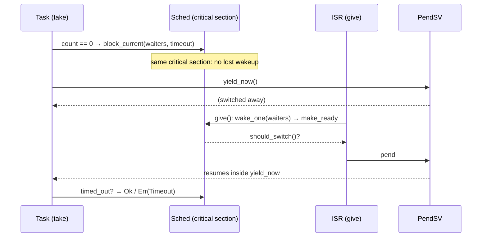

# M3: Semaphore, Queue, Interrupt → Task — Implementation Plan

> **For agentic workers:** REQUIRED SUB-SKILL: Use superpowers:subagent-driven-development (recommended) or superpowers:executing-plans to implement this plan task-by-task. Steps use checkbox (`- [ ]`) syntax for tracking.
>
> **Ownership:** Tasks 1 and 6 are Claude's (harness, review, docs). Tasks 2–5 are the **user's** (kernel core). An agent MUST NOT write the non-test parts of `task.rs`, `ring.rs`, `sched.rs` or `sync.rs` unless the user asks; it may explain and review.

**Goal:** Tasks can block on a semaphore or a queue, with an optional timeout, and be woken by another task or an interrupt handler; the most urgent waiter goes first.

**Architecture:** A blocked task sits on the sync object's `WaitList` (priority-ordered, linked through `Task::wait_next`) and, if it has a timeout, on the sleep list at the same time (through `Task::next`). Whoever wakes it first, `wake_one` (event) or `tick` (timeout), removes it from the other list. All wait-list logic lives in `Sched` (pure, host-tested); `sync.rs` holds thin `Semaphore`/`Queue` wrappers that do their whole decision inside one `with_sched` call. Queue storage is a pure `Ring<T, N>`.

**Tech Stack:** M2 kernel; `rp235x-hal` TIMER0 alarm + `pac::interrupt` for the interrupt test.

**Spec:** `docs/superpowers/specs/2026-10-14-rtos-kernel-design.md` (section 4, milestone M3)

## Global Constraints

- Everything in the M0–M2 plans' Global Constraints still holds.
- Timeouts are `Option<Duration>` (`core::time::Duration`, re-exported as `kernel::Duration`): `None` waits forever, `Some(Duration::ZERO)` never blocks. Changed after the plan was written (was `Option<u32>` ticks); the test binaries are updated.
- Handoff: a woken task receives the unit/item directly; it never re-competes for it.
- **No lost wakeups:** "decide to wait" and "join the wait list" happen inside ONE `with_sched` call.
- Only `give`, `try_send`, `try_recv` may be called from interrupt handlers.
- Verified on this board with a throwaway reference (2026-10-14): 31 host tests, `m3_sem` (interrupt→task worst latency 8 µs), `m3_queue`, and M1/M2 regressions pass; `m3_queue` fails (`items out of order`) against a queue that drops a blocked sender's item.

## Fixed interfaces

```rust
// kernel/src/task.rs
pub(crate) enum State { Ready, Running, Sleeping, Blocked }
pub struct Task {
    // M2 fields, plus:
    pub(crate) waiting_on: *mut WaitList, // wait list while Blocked, else null
    pub(crate) wait_next: *mut Task,      // link inside `waiting_on`
    pub(crate) timed_out: bool,           // set by `tick` when the timeout won
    pub(crate) msg: *mut (),              // queue handoff: points at an Option<T> on this task's stack
}

// kernel/src/sched.rs
pub(crate) struct WaitList { head: *mut Task }
impl WaitList { pub(crate) const fn new() -> Self; #[cfg(test)] pub(crate) fn is_empty(&self) -> bool; }
impl Sched {
    pub(crate) unsafe fn block_current(&mut self, wl: *mut WaitList, timeout: Option<Duration>); // caller pends
    pub(crate) unsafe fn wake_one(&mut self, wl: *mut WaitList) -> *mut Task;             // null if none
    pub(crate) fn should_switch(&self) -> bool; // a ready task >= current priority
    // tick(): also times out Blocked sleepers; returns should_switch()
}

// kernel/src/ring.rs
pub(crate) struct Ring<T, const N: usize> { /* .. */ }
impl<T, const N: usize> Ring<T, N> {
    pub(crate) const fn new() -> Self;            // panics at compile time if N == 0
    pub(crate) fn is_full(&self) -> bool;
    pub(crate) fn push(&mut self, item: T) -> Result<(), T>;
    pub(crate) fn pop(&mut self) -> Option<T>;
}                                                // + Drop drops queued items

// kernel/src/sync.rs (Arm only), re-exported from lib.rs
pub struct Timeout;                               // Debug, PartialEq, Eq, Clone, Copy
pub struct Semaphore;                             // Sync
impl Semaphore {
    pub const fn new(count: u32) -> Self;
    pub fn take(&self, timeout: Option<Duration>) -> Result<(), Timeout>;
    pub fn give(&self);                           // ISR-safe
}
pub struct Queue<T, const N: usize>;              // Sync if T: Send
impl<T, const N: usize> Queue<T, N> {
    pub const fn new() -> Self;
    pub fn send(&self, item: T, timeout: Option<Duration>) -> Result<(), T>; // Err returns the item
    pub fn recv(&self, timeout: Option<Duration>) -> Result<T, Timeout>;
    pub fn try_send(&self, item: T) -> Result<(), T>;                   // ISR-safe
    pub fn try_recv(&self) -> Result<T, Timeout>;                       // ISR-safe
}

// kernel/src/arch/mod.rs: `with_sched` becomes pub(crate)
```

## A blocking call, end to end



---

### Task 1 (Claude): M3 harness

**Files:**
- Modify: `kernel/src/lib.rs`, `kernel/src/task.rs` (the `#[cfg(test)]` `for_test` block only), `kernel/src/sched/tests.rs` (append), `kernel/src/arch/mod.rs` (`pub(crate) fn with_sched`)
- Create: `kernel/src/ring/tests.rs`, `app/src/bin/m3_sem.rs`, `app/src/bin/m3_queue.rs`

- [ ] **Step 1: `kernel/src/lib.rs`**

```rust
//! ros kernel. Pure logic is host-testable; `arch` and `sync` are Cortex-M33 only.
#![cfg_attr(not(test), no_std)]

mod ring;
mod sched;
mod task;
pub use task::{Stack, Task};

#[cfg(target_arch = "arm")]
mod arch;
#[cfg(target_arch = "arm")]
mod sync;
#[cfg(target_arch = "arm")]
pub use arch::{now, sleep, sleep_until, start, yield_now};
#[cfg(target_arch = "arm")]
pub use sync::{Queue, Semaphore, Timeout};
```

- [ ] **Step 2: `Task::for_test` with the new fields**

```rust
#[cfg(test)]
impl Task {
    /// Stackless task for scheduler tests: only the fields `Sched` reads are meaningful.
    pub(crate) fn for_test(prio: u8) -> Task {
        Task {
            sp: core::ptr::null_mut(),
            stack_limit: core::ptr::null_mut(),
            state: State::Ready,
            current_priority: prio,
            original_priority: prio,
            wake: 0,
                waiting_on: core::ptr::null_mut(),
                wait_next: core::ptr::null_mut(),
                timed_out: false,
                msg: core::ptr::null_mut(),
            next: core::ptr::null_mut(),
            name: "t",
        }
    }
}
```

- [ ] **Step 3: append to `kernel/src/sched/tests.rs`**

```rust
// ---- M3: wait lists and timeouts ----

fn wait_list() -> Box<WaitList> {
    Box::new(WaitList::new())
}

#[test]
fn waiters_wake_most_urgent_first_then_fifo() {
    let (mut s, _, t, _own) = sched_with(&[1, 3, 1]);
    let mut wl = wait_list();
    for &want in &[t[1], t[0], t[2]] {
        assert_eq!(s.switch(), want);
        unsafe { s.block_current(&mut *wl, None) };
    }
    let order: Vec<_> = (0..4).map(|_| unsafe { s.wake_one(&mut *wl) }).collect();
    assert_eq!(order, [t[1], t[0], t[2], std::ptr::null_mut()]);
    assert!(wl.is_empty());
}

#[test]
fn timed_wait_expires_on_its_tick() {
    let (mut s, idle, t, _own) = sched_with(&[1]);
    let mut wl = wait_list();
    s.switch();
    unsafe { s.block_current(&mut *wl, Some(3)) };
    assert_eq!(s.switch(), idle);
    assert!(!s.tick());
    assert!(!s.tick());
    assert!(s.tick(), "tick 3: timeout woke the task");
    assert!(wl.is_empty(), "timed-out task still on the wait list");
    assert_eq!(s.switch(), t[0]);
    assert!(unsafe { (*t[0]).timed_out });
}

#[test]
fn event_cancels_the_timeout() {
    let (mut s, idle, t, _own) = sched_with(&[1]);
    let (mut a, mut b) = (wait_list(), wait_list());
    s.switch();
    unsafe { s.block_current(&mut *a, Some(5)) };
    s.switch();
    assert_eq!(unsafe { s.wake_one(&mut *a) }, t[0]);
    assert_eq!(s.switch(), t[0]);
    assert!(!unsafe { (*t[0]).timed_out });
    // Now wait forever elsewhere: the old 5-tick timer must not fire.
    unsafe { s.block_current(&mut *b, None) };
    assert_eq!(s.switch(), idle);
    for _ in 0..10 {
        s.tick();
    }
    assert_eq!(s.switch(), idle, "a cancelled timeout woke the task");
    assert_eq!(unsafe { s.wake_one(&mut *b) }, t[0]);
}

#[test]
fn untimed_wait_never_times_out() {
    let (mut s, idle, _, _own) = sched_with(&[1]);
    let mut wl = wait_list();
    s.switch();
    unsafe { s.block_current(&mut *wl, None) };
    s.switch();
    for _ in 0..1000 {
        s.tick();
    }
    assert_eq!(s.switch(), idle);
    assert!(!wl.is_empty());
}

#[test]
fn waking_a_more_urgent_waiter_requests_a_switch() {
    let (mut s, _, t, _own) = sched_with(&[3, 1]);
    let mut wl = wait_list();
    assert_eq!(s.switch(), t[0]);
    unsafe { s.block_current(&mut *wl, None) };
    assert_eq!(s.switch(), t[1]);
    assert!(!s.should_switch());
    unsafe { s.wake_one(&mut *wl) };
    assert!(s.should_switch(), "woke priority 3 while priority 1 runs");
}

#[test]
fn waking_a_less_urgent_waiter_does_not_switch() {
    let (mut s, _, t, _own) = sched_with(&[1, 3]);
    let mut wl = wait_list();
    assert_eq!(s.switch(), t[1]);
    // t[1] must step aside so t[0] can block, then come back.
    s.sleep_current(1);
    assert_eq!(s.switch(), t[0]);
    unsafe { s.block_current(&mut *wl, None) };
    s.switch();
    s.tick();
    assert_eq!(s.switch(), t[1]);
    unsafe { s.wake_one(&mut *wl) };
    assert!(!s.should_switch());
}

#[test]
fn waiter_woken_before_its_switch_is_not_queued_twice() {
    // Race: a task blocks, but an interrupt gives before PendSV runs.
    let (mut s, idle, t, _own) = sched_with(&[1]);
    let mut wl = wait_list();
    assert_eq!(s.switch(), t[0]);
    unsafe {
        s.block_current(&mut *wl, None);
        s.wake_one(&mut *wl);
    }
    assert_eq!(s.switch(), t[0]);
    s.sleep_current(10);
    assert_eq!(s.switch(), idle, "a stale second queue entry ran a sleeping task");
}
```

- [ ] **Step 4: `kernel/src/ring/tests.rs`**

```rust
//! Host tests for the ring buffer. Run: `cargo ktest`.
use super::*;
use std::rc::Rc;

#[test]
fn fifo_order() {
    let mut r: Ring<u32, 4> = Ring::new();
    for i in 1..=3 {
        r.push(i).unwrap();
    }
    assert_eq!([r.pop(), r.pop(), r.pop(), r.pop()], [Some(1), Some(2), Some(3), None]);
}

#[test]
fn full_ring_rejects_and_returns_item() {
    let mut r: Ring<u32, 2> = Ring::new();
    r.push(1).unwrap();
    r.push(2).unwrap();
    assert!(r.is_full());
    assert_eq!(r.push(3), Err(3));
}

#[test]
fn wraps_around_many_times() {
    let mut r: Ring<u32, 3> = Ring::new();
    let mut next_out = 0;
    for i in 0..100 {
        r.push(i).unwrap();
        if r.is_full() {
            assert_eq!(r.pop(), Some(next_out));
            next_out += 1;
        }
    }
    while let Some(v) = r.pop() {
        assert_eq!(v, next_out);
        next_out += 1;
    }
    assert_eq!(next_out, 100);
}

#[test]
fn dropping_ring_drops_queued_items() {
    let item = Rc::new(());
    {
        let mut r: Ring<Rc<()>, 4> = Ring::new();
        r.push(item.clone()).unwrap();
        r.push(item.clone()).unwrap();
        r.pop();
        assert_eq!(Rc::strong_count(&item), 2);
    }
    assert_eq!(Rc::strong_count(&item), 1, "queued item leaked");
}
```

- [ ] **Step 5: `app/src/bin/m3_sem.rs`** (interrupt → task through a TIMER0 alarm; the spec's GPIO button is replaced by a timer so the test runs unattended)

```rust
//! M3: semaphore. Checks timeout, try-take, counting, and interrupt -> task:
//! a TIMER0 alarm interrupt `give`s every 3 ms; a task blocked in `take` must
//! wake within microseconds of each give.
#![no_std]
#![no_main]

use core::sync::atomic::{AtomicU32, Ordering::Relaxed};
use kernel::{Semaphore, Stack, Task, Timeout};
use rp235x_hal as hal;
use hal::fugit::MicrosDurationU32;
use hal::pac::interrupt;
use hal::timer::Alarm;

type Timer = hal::Timer<hal::timer::CopyableTimer0>;
type Alarm0 = hal::timer::Alarm0<hal::timer::CopyableTimer0>;

const PERIOD: MicrosDurationU32 = MicrosDurationU32::millis(3);
const ROUNDS: u32 = 20;

static NEVER: Semaphore = Semaphore::new(0);
static COUNTED: Semaphore = Semaphore::new(0);
static IRQ: Semaphore = Semaphore::new(0);
/// TIMER0 low word at the moment the ISR gave `IRQ`.
static GIVEN_AT: AtomicU32 = AtomicU32::new(0);

static mut TIMER: Option<Timer> = None;
static mut ALARM: Option<Alarm0> = None;
static STACK: Stack<1024> = Stack::new();

fn micros() -> u32 {
    // SAFETY: written once in `main` before the kernel starts; read-only afterwards.
    unsafe { (*&raw const TIMER).unwrap() }.get_counter_low()
}

#[interrupt]
fn TIMER0_IRQ_0() {
    // SAFETY: only this handler touches ALARM after `main` armed it.
    let alarm = unsafe { (*&raw mut ALARM).as_mut().unwrap() };
    alarm.clear_interrupt();
    alarm.schedule(PERIOD).unwrap();
    GIVEN_AT.store(micros(), Relaxed);
    IRQ.give();
}

fn waiter() -> ! {
    // Timeout: nobody ever gives NEVER.
    let t0 = kernel::now();
    assert_eq!(NEVER.take(Some(5)), Err(Timeout));
    assert_eq!(kernel::now() - t0, 5, "timed take did not last 5 ticks");
    assert_eq!(NEVER.take(Some(Duration::ZERO)), Err(Timeout), "try-take blocked or succeeded");
    defmt::info!("timeout ok");

    // Counting: gives with nobody waiting accumulate.
    COUNTED.give();
    COUNTED.give();
    assert_eq!(COUNTED.take(Some(Duration::ZERO)), Ok(()));
    assert_eq!(COUNTED.take(Some(Duration::ZERO)), Ok(()));
    assert_eq!(COUNTED.take(Some(Duration::ZERO)), Err(Timeout), "count went above 2");
    defmt::info!("counting ok");

    // Interrupt -> task.
    // SAFETY: the alarm is armed before its interrupt is unmasked.
    unsafe {
        let alarm = (*&raw mut ALARM).as_mut().unwrap();
        alarm.enable_interrupt();
        alarm.schedule(PERIOD).unwrap();
        cortex_m::peripheral::NVIC::unmask(hal::pac::Interrupt::TIMER0_IRQ_0);
    }
    let mut worst = 0;
    for _ in 0..ROUNDS {
        assert_eq!(IRQ.take(Some(10)), Ok(()), "interrupt give never arrived");
        let latency = micros().wrapping_sub(GIVEN_AT.load(Relaxed));
        worst = worst.max(latency);
    }
    cortex_m::peripheral::NVIC::mask(hal::pac::Interrupt::TIMER0_IRQ_0);
    defmt::info!("irq -> task: {} wakeups, worst latency {} us", ROUNDS, worst);
    assert!(worst < 50, "task woke {} us after the give", worst);
    app::exit_ok()
}

#[app::entry]
fn main() -> ! {
    let mut b = app::init();
    // SAFETY: no task or interrupt is running yet.
    unsafe {
        *&raw mut ALARM = b.timer.alarm_0();
        *&raw mut TIMER = Some(b.timer);
    }
    let mut tasks = [Task::new("waiter", 2, waiter, &STACK)];
    kernel::start(&mut tasks, b.sys_hz)
}
```

- [ ] **Step 6: `app/src/bin/m3_queue.rs`**

```rust
//! M3: queue. A producer (prio 1) streams 200 numbers to a consumer (prio 2)
//! through a 4-slot queue. The consumer pauses now and then so the queue fills
//! and the producer must block on "full". Then: full queue rejects try_send,
//! send times out and returns the item, empty queue times out recv.
#![no_std]
#![no_main]

use kernel::{Queue, Semaphore, Stack, Task, Timeout};

const ITEMS: u32 = 200;
static Q: Queue<u32, 4> = Queue::new();
/// Producer -> consumer: "the queue is full and the timeouts are checked".
static FILLED: Semaphore = Semaphore::new(0);
static STACK_P: Stack<1024> = Stack::new();
static STACK_C: Stack<1024> = Stack::new();

fn producer() -> ! {
    for i in 0..ITEMS {
        Q.send(i, None).unwrap();
    }
    // The consumer is now asleep: fill the queue and check "full" behavior.
    for i in 0..4 {
        Q.try_send(1000 + i).unwrap();
    }
    assert_eq!(Q.try_send(7), Err(7), "try_send on a full queue");
    let t0 = kernel::now();
    assert_eq!(Q.send(8, Some(3)), Err(8), "timed send on a full queue");
    assert_eq!(kernel::now() - t0, 3, "timed send did not last 3 ticks");
    defmt::info!("full queue: try_send rejected, send timed out and returned the item");
    FILLED.give();
    loop {
        kernel::sleep(1000);
    }
}

fn consumer() -> ! {
    for i in 0..ITEMS {
        assert_eq!(Q.recv(None), Ok(i), "items out of order");
        if i % 50 == 49 {
            kernel::sleep(1); // let the producer fill the queue and block
        }
    }
    defmt::info!("{} items in order", ITEMS);
    FILLED.take(None).unwrap();
    for i in 0..4 {
        assert_eq!(Q.try_recv(), Ok(1000 + i));
    }
    let t0 = kernel::now();
    assert_eq!(Q.recv(Some(3)), Err(Timeout), "recv on an empty queue");
    assert_eq!(kernel::now() - t0, 3, "timed recv did not last 3 ticks");
    defmt::info!("empty queue: recv timed out");
    app::exit_ok()
}

#[app::entry]
fn main() -> ! {
    let b = app::init();
    let mut tasks = [Task::new("producer", 1, producer, &STACK_P), Task::new("consumer", 2, consumer, &STACK_C)];
    kernel::start(&mut tasks, b.sys_hz)
}
```

- [ ] **Step 7: `pub(crate) fn with_sched` in `arch/mod.rs`, then commit the red harness**

```bash
git add kernel app
git commit -m "test(m3): wait-list/ring host tests, semaphore/queue board tests (red)"
```

---

### Task 2 (User): task fields — `kernel/src/task.rs`

**Goal:** compiles against the fixed `Task` interface (remaining errors only from Tasks 3–5).

1. Add `State::Blocked`.
2. Add `waiting_on`, `wait_next`, `timed_out`, `msg` (all `pub(crate)`), initialized to null/false in `build`.

**Why two links:** a task waiting with a timeout is on the sync object's wait list *and* on the sleep list at the same time. `next` already serves ready/sleep lists, so the wait list needs its own `wait_next`.

---

### Task 3 (User): ring buffer — `kernel/src/ring.rs`

**Goal:** the 4 `ring::tests` pass.

- Storage `[MaybeUninit<T>; N]` plus `head` (oldest) and `len`. Slot of the next push: `(head + len) % N`.
- `const fn new`: `[const { MaybeUninit::uninit() }; N]`, and `assert!(N > 0)`.
- `pop` moves the item out with `assume_init_read` (the slot leaves the initialized range, so it is read exactly once).
- `Drop`: pop until empty, so queued items are dropped (`dropping_ring_drops_queued_items`).

**Why `MaybeUninit`:** a queue of `T` must not require `T: Default` or `Copy`, and empty slots hold no value.

---

### Task 4 (User): wait lists — `kernel/src/sched.rs`

**Goal:** all 31 host tests pass.

1. `WaitList { head }`: `const fn new`, `#[cfg(test)] is_empty`.
2. Refactor: move the sorted insert out of `sleep_current` into `unsafe fn insert_sleeper(t, until)` (it sets `wake`); add `unsafe fn remove_sleeper(t)` (walk with a link pointer; no-op if absent).
3. `block_current(wl, timeout)`: assert running; `state = Blocked`, `timed_out = false`, `waiting_on = wl`; insert into `wl` after every task with `current_priority >= ` its own (most urgent first, FIFO on ties) via `wait_next`; if `Some(t)`, `insert_sleeper(cur, now + t)`.
4. `wake_one(wl)`: pop the head (null if empty), clear its `wait_next`/`waiting_on`, `remove_sleeper` it (cancel the timeout), `make_ready`, return it.
5. `should_switch()`: the comparison that ends `tick`, as its own method; `tick` returns it.
6. In `tick`, a woken sleeper whose state is `Blocked` timed out: unlink it from `*waiting_on` (walk `wait_next`), set `timed_out = true`, then `make_ready`.

**Hints**
- `remove_sleeper` must run *before* `make_ready`: `make_ready` reuses `next`.
- `event_cancels_the_timeout` is the bug to watch: if `wake_one` forgets `remove_sleeper`, the old timer later "wakes" a task that is blocked somewhere else.

---

### Task 5 (User): semaphore and queue — `kernel/src/sync.rs`

**Goal:** `m3_sem` and `m3_queue` exit 0; M1/M2 binaries still pass.

**Shape of every call:** one `with_sched` that either finishes the operation or calls `block_current`; then, outside it, `yield_now()` if needed; after resuming, read `timed_out` (in another `with_sched`).

**Semaphore** (`UnsafeCell<{ count, waiters }>`, `unsafe impl Sync`)
- `take`: `count > 0` → decrement, `Ok`. Else `Some(Duration::ZERO)` → `Err(Timeout)`. Else block on `waiters`, yield, then `Err` if `timed_out` else `Ok` (the giver handed the unit over).
- `give`: `wake_one(waiters)`; if nobody, `count += 1`. If `should_switch()`, `yield_now()` (works from an ISR too: it only pends).

**Queue** (`UnsafeCell<{ ring, receivers, senders }>`, `unsafe impl<T: Send> Sync`)
- `send`: a receiver waits → write the item into its `msg` slot (`*mut Option<T>`), wake it. Else ring has room → push. Else `Some(Duration::ZERO)` → `Err(item)`. Else park the item in a local `Option<T>` on your stack, point `current.msg` at it, block on `senders`. After a timeout, take it back out and return `Err(item)`.
- `recv`: ring non-empty → pop; if a sender is parked, wake it and move its item into the ring. Else `Some(Duration::ZERO)` → `Err(Timeout)`. Else point `current.msg` at a local `Option<T>`, block on `receivers`; after waking, `Ok(slot.take())`.
- `try_send` / `try_recv` = timeout `Some(Duration::ZERO)`.

**Hints**
- The lost wakeup: if `take` checks `count == 0` in one critical section and blocks in a second, an ISR `give` landing between them increments `count` while you go to sleep, so you wait for a unit that is already there. One critical section for both.
- A local `Option<T>` on a blocked task's stack is safe to write from another task: the blocked task cannot run (or return) until it is woken, and it is woken only after the write.
- Get raw pointers to fields of the `UnsafeCell` contents with `addr_of_mut!((*me).waiters)`.

**Verify**
- `cargo run --release --bin m3_sem` → `timeout ok`, `counting ok`, `irq -> task: 20 wakeups, worst latency … us` (reference: 8 µs), `TEST PASS`.
- `cargo run --release --bin m3_queue` → `200 items in order`, `full queue: …`, `empty queue: recv timed out`, `TEST PASS`.
- Re-run `m2_sleep`, `m2_preempt`, `m1_coop`, `m1_overflow`.

---

### Task 6 (Claude): review, docs, commit

- [ ] Review Tasks 2–5 against this plan and spec section 4.
- [ ] Run all host tests and board binaries.
- [ ] Spec: interrupt→task via TIMER0 alarm; timeouts `Option<Duration>`; `send` returns the item on failure; new `Task` fields; `Ring`.
- [ ] Commit.
