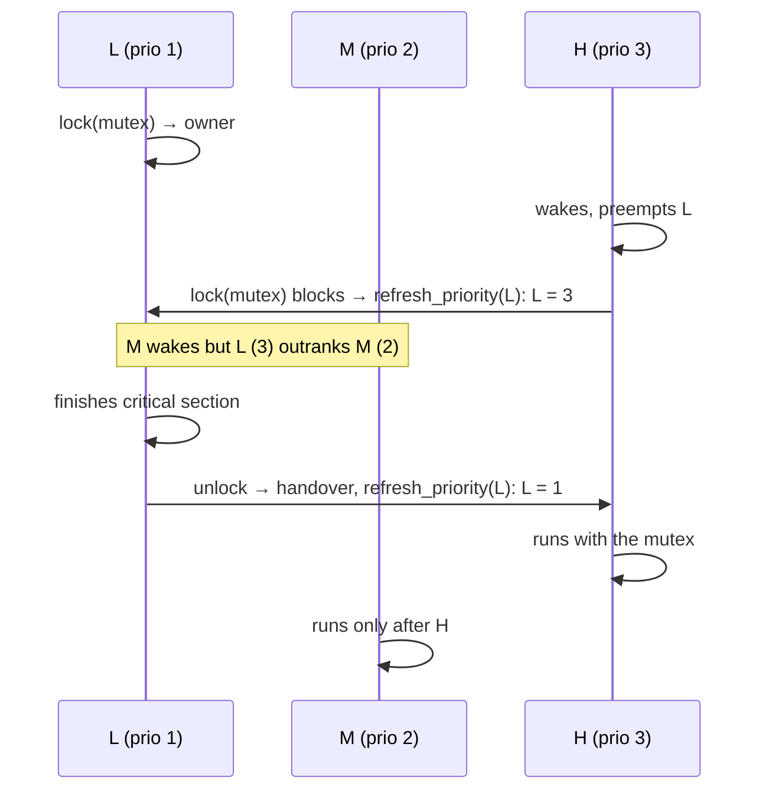

# M4: Mutex with Priority Inheritance — Implementation Plan

> **For agentic workers:** REQUIRED SUB-SKILL: Use superpowers:subagent-driven-development (recommended) or superpowers:executing-plans to implement this plan task-by-task. Steps use checkbox (`- [ ]`) syntax for tracking.
>
> **Ownership:** Tasks 1 and 5 are Claude's (harness, review, docs). Tasks 2–4 are the **user's** (kernel core). An agent MUST NOT write the non-test parts of `task.rs`, `sched.rs` or `sync.rs` unless the user asks; it may explain and review.

**Goal:** `Mutex<T>` that one task at a time can lock (with optional timeout), unlocking on guard drop; while a more urgent task waits, the owner runs at that task's priority (transitively through chains of mutexes), and drops back exactly when it no longer needs the boost.

**Architecture:** The kernel half of a mutex, `MutexCore { owner, waiters, next_held }`, lives in `sched.rs` with all inheritance logic (pure, host-tested). Each task tracks the mutexes it holds (`held`, a list through `next_held`) and the mutex it is blocked on (`bloVVcked_mutex`). One function, `refresh_priority(t)`, recomputes a task's effective priority from scratch (`original_priority` raised to the head waiter of each held mutex) and walks the chain to the next owner; lock, unlock and timeout all just call it. `set_priority` keeps the task sorted in whichever priority-ordered list it is in. `sync.rs` adds a thin `Mutex<T>` + `MutexGuard`.

**Tech Stack:** M3 kernel; `cortex_m::peripheral::SCB::vect_active` for the "task context only" check.

**Spec:** `docs/superpowers/specs/2026-10-14-rtos-kernel-design.md` (section 4 Mutex, milestone M4)

## Global Constraints

- Everything in the M0–M3 plans' Global Constraints still holds.
- Not recursive: locking a mutex you already own panics (`"mutex locked twice by the same task"`).
- Only the owner unlocks (`MutexGuard` is `!Send`); unlocking hands the mutex straight to the most urgent waiter.
- Task context only: `lock` asserts `SCB::vect_active() == VectActive::ThreadMode`.
- The scheduler always uses `current_priority`; `original_priority` never changes.
- Verified on this board with a throwaway reference (2026-10-14): 40 host tests, `m4_inversion` (H waited 8 ms), `m4_mutex` (counter 200/200, timeouts), and M3 regressions pass. Mutants caught: no inheritance → H waited 201 ms, `m4_inversion` fails "priority inversion" (and 5 host tests fail); lock released mid-update → counter 100/200, `m4_mutex` fails "lost updates".

## Fixed interfaces

```rust
// kernel/src/task.rs: two new fields
pub(crate) held: *mut MutexCore,          // mutexes this task owns, via MutexCore::next_held
pub(crate) blocked_mutex: *mut MutexCore, // mutex this task is blocked on, else null

// kernel/src/sched.rs
#[derive(Debug, PartialEq)]
pub(crate) enum Lock { Acquired, WouldBlock, Blocked }
pub(crate) struct MutexCore { owner: *mut Task, waiters: WaitList, next_held: *mut MutexCore }
impl MutexCore { pub(crate) const fn new() -> Self; #[cfg(test)] pub(crate) fn owner(&self) -> *mut Task; }
impl List { unsafe fn unlink(&mut self, t: *mut Task); }  // t must be in the list
impl Sched {
    unsafe fn set_priority(&mut self, t: *mut Task, p: u8);       // re-sorts t in its ready/wait list
    unsafe fn refresh_priority(&mut self, t: *mut Task);          // recompute + walk the chain
    pub(crate) unsafe fn lock_current(&mut self, m: *mut MutexCore, timeout: Option<Duration>) -> Lock;
    pub(crate) unsafe fn unlock_current(&mut self, m: *mut MutexCore) -> bool; // switch needed?
    // tick(): a timed-out mutex waiter clears blocked_mutex and refreshes the owner
}

// kernel/src/sync.rs, re-exported from lib.rs
pub struct Mutex<T>;                                   // Sync if T: Send
impl<T> Mutex<T> {
    pub const fn new(value: T) -> Self;
    pub fn lock(&self, timeout: Option<Duration>) -> Result<MutexGuard<'_, T>, Timeout>;
}
pub struct MutexGuard<'a, T>;                          // Deref, DerefMut, Drop = unlock, !Send
```

## Priority inheritance in one picture



---

### Task 1 (Claude): M4 harness

**Files:** `kernel/src/lib.rs` (export `Mutex`, `MutexGuard`), `kernel/src/task.rs` (`for_test` sets the two new fields), `kernel/src/sched/tests.rs` (append), create `app/src/bin/m4_inversion.rs`, `app/src/bin/m4_mutex.rs`.

- [ ] **Step 1: append to `kernel/src/sched/tests.rs`**

```rust
// ---- M4: mutex and priority inheritance ----

fn mutex() -> Box<MutexCore> {
    Box::new(MutexCore::new())
}

fn prio(t: *mut Task) -> u8 {
    unsafe { (*t).current_priority }
}

#[test]
fn free_mutex_is_taken_and_handed_back() {
    let (mut s, _, t, _own) = sched_with(&[1]);
    let mut m = mutex();
    s.switch();
    assert_eq!(unsafe { s.lock_current(&mut *m, None) }, Lock::Acquired);
    assert_eq!(m.owner(), t[0]);
    assert!(!unsafe { s.unlock_current(&mut *m) });
    assert!(m.owner().is_null());
}

#[test]
fn zero_timeout_on_held_mutex_does_not_block() {
    let (mut s, _, t, _own) = sched_with(&[2, 1]);
    let mut m = mutex();
    assert_eq!(s.switch(), t[0]);
    unsafe { s.lock_current(&mut *m, None) };
    s.sleep_current(at(1));
    assert_eq!(s.switch(), t[1]);
    assert_eq!(unsafe { s.lock_current(&mut *m, Some(Duration::ZERO)) }, Lock::WouldBlock);
    assert_eq!(prio(t[0]), 2, "a try-lock must not boost the owner");
}

#[test]
#[should_panic(expected = "mutex locked twice by the same task")]
fn locking_twice_from_the_same_task_panics() {
    let (mut s, _, _, _own) = sched_with(&[1]);
    let mut m = mutex();
    s.switch();
    unsafe {
        s.lock_current(&mut *m, None);
        s.lock_current(&mut *m, None);
    }
}

/// Classic inversion: L owns the mutex, M is ready, H blocks on the mutex.
/// Returns (sched, [L, M, H], mutex).
fn inversion() -> (Sched, Vec<*mut Task>, Box<MutexCore>, Tasks) {
    let (mut s, _, t, own) = sched_with(&[1, 2, 3]);
    let mut m = mutex();
    // H and M step aside so L can run and take the mutex.
    assert_eq!(s.switch(), t[2]);
    s.sleep_current(at(1));
    assert_eq!(s.switch(), t[1]);
    s.sleep_current(at(1));
    assert_eq!(s.switch(), t[0]);
    unsafe { s.lock_current(&mut *m, None) };
    // Both wake; H preempts L and blocks on the mutex.
    assert!(s.tick());
    assert_eq!(s.switch(), t[2]);
    assert_eq!(unsafe { s.lock_current(&mut *m, None) }, Lock::Blocked);
    (s, t, m, own)
}

#[test]
fn owner_inherits_the_waiters_priority_and_runs_before_medium() {
    let (mut s, t, _m, _own) = inversion();
    assert_eq!(prio(t[0]), 3, "L must run at H's priority");
    assert_eq!(s.switch(), t[0], "M ran while H waited for L: priority inversion");
}

#[test]
fn unlock_hands_over_and_restores_the_owner() {
    let (mut s, t, mut m, _own) = inversion();
    assert_eq!(s.switch(), t[0]);
    assert!(unsafe { s.unlock_current(&mut *m) }, "H outranks L now: switch");
    assert_eq!(m.owner(), t[2], "handed straight to the waiter");
    assert_eq!(prio(t[0]), 1, "L back to its own priority");
    assert_eq!(s.switch(), t[2]);
    assert_eq!(s.switch(), t[2], "H keeps the CPU");
}

#[test]
fn inheritance_follows_a_chain_of_mutexes() {
    // L holds A. M holds B and blocks on A. H blocks on B: L must reach 3.
    let (mut s, _, t, _own) = sched_with(&[1, 2, 3]);
    let (mut a, mut b) = (mutex(), mutex());
    assert_eq!(s.switch(), t[2]);
    s.sleep_current(at(2));
    assert_eq!(s.switch(), t[1]);
    s.sleep_current(at(1));
    assert_eq!(s.switch(), t[0]);
    unsafe { s.lock_current(&mut *a, None) };
    s.tick(); // M wakes
    assert_eq!(s.switch(), t[1]);
    unsafe {
        s.lock_current(&mut *b, None);
        s.lock_current(&mut *a, None); // M blocks on A: L -> 2
    }
    assert_eq!(prio(t[0]), 2);
    s.switch();
    s.tick(); // H wakes
    assert_eq!(s.switch(), t[2]);
    unsafe { s.lock_current(&mut *b, None) }; // H blocks on B: M -> 3, then L -> 3
    assert_eq!(prio(t[1]), 3);
    assert_eq!(prio(t[0]), 3, "boost did not propagate along the chain");
}

#[test]
fn owner_keeps_the_boost_of_mutexes_it_still_holds() {
    // L holds A and B; M waits on B, H waits on A. Unlocking A drops L to 2, not 1.
    let (mut s, _, t, _own) = sched_with(&[1, 2, 3]);
    let (mut a, mut b) = (mutex(), mutex());
    assert_eq!(s.switch(), t[2]);
    s.sleep_current(at(1));
    assert_eq!(s.switch(), t[1]);
    s.sleep_current(at(1));
    assert_eq!(s.switch(), t[0]);
    unsafe {
        s.lock_current(&mut *a, None);
        s.lock_current(&mut *b, None);
    }
    s.tick();
    assert_eq!(s.switch(), t[2]);
    unsafe { s.lock_current(&mut *a, None) };
    assert_eq!(s.switch(), t[0], "boosted L outranks M");
    s.sleep_current(at(2)); // L steps aside so M can block on B
    assert_eq!(s.switch(), t[1]);
    unsafe { s.lock_current(&mut *b, None) };
    assert_eq!(prio(t[0]), 3);
    s.switch();
    s.tick(); // L wakes
    assert_eq!(s.switch(), t[0]);
    unsafe { s.unlock_current(&mut *a) };
    assert_eq!(prio(t[0]), 2, "M still waits on B, which L holds");
}

#[test]
fn timed_out_waiter_withdraws_its_boost() {
    let (mut s, _, t, _own) = sched_with(&[1, 3]);
    let mut m = mutex();
    assert_eq!(s.switch(), t[1]);
    s.sleep_current(at(1));
    assert_eq!(s.switch(), t[0]);
    unsafe { s.lock_current(&mut *m, None) };
    s.tick();
    assert_eq!(s.switch(), t[1]);
    unsafe { s.lock_current(&mut *m, Some(ms(2))) };
    assert_eq!(prio(t[0]), 3);
    s.switch();
    s.tick();
    s.tick(); // H times out
    assert_eq!(prio(t[0]), 1, "L kept the boost of a waiter that left");
    assert_eq!(m.owner(), t[0]);
}
```

- [ ] **Step 2: `app/src/bin/m4_inversion.rs`**

```rust
//! M4: classic priority inversion. L (prio 1) holds a mutex for ~10 ms of CPU
//! work. H (prio 3) wakes at 2 ms and blocks on it. M (prio 2) wakes at 3 ms
//! and burns the CPU for 200 ms. Without inheritance M starves L, so H waits
//! ~200 ms; with it L runs at H's priority, finishes, and H gets the mutex at
//! ~10 ms, before M is done.
#![no_std]
#![no_main]

use core::sync::atomic::{AtomicU32, Ordering::SeqCst};
use kernel::{Duration, Instant, Mutex, Stack, Task};

static LOCK: Mutex<()> = Mutex::new(());
/// Bit 0: H got the mutex. Bit 1: M finished burning.
static EVENTS: AtomicU32 = AtomicU32::new(0);
static STACK_L: Stack<512> = Stack::new();
static STACK_M: Stack<512> = Stack::new();
static STACK_H: Stack<1024> = Stack::new();

/// Busy CPU work until `until` (preemptible, unlike sleep).
fn burn_until(until: Instant) {
    while kernel::now() < until {}
}

fn low() -> ! {
    let start = kernel::now();
    let guard = LOCK.lock(None).unwrap();
    burn_until(start + Duration::from_millis(10));
    drop(guard);
    loop {
        kernel::sleep(Duration::from_secs(1));
    }
}

fn medium() -> ! {
    kernel::sleep(Duration::from_millis(3));
    let t0 = kernel::now();
    burn_until(t0 + Duration::from_millis(200));
    EVENTS.fetch_or(2, SeqCst);
    loop {
        kernel::sleep(Duration::from_secs(1));
    }
}

fn high() -> ! {
    kernel::sleep(Duration::from_millis(2));
    let t0 = kernel::now();
    let guard = LOCK.lock(None).unwrap();
    let waited = kernel::now() - t0;
    EVENTS.fetch_or(1, SeqCst);
    drop(guard);
    defmt::info!("H waited {} ms for the mutex", waited.as_millis() as u32);
    assert_eq!(EVENTS.load(SeqCst) & 2, 0, "M finished first: priority inversion");
    assert!(waited < Duration::from_millis(15), "H waited {} ms", waited.as_millis() as u32);
    app::exit_ok()
}

#[app::entry]
fn main() -> ! {
    let b = app::init();
    let mut tasks = [
        Task::new("low", 1, low, &STACK_L),
        Task::new("medium", 2, medium, &STACK_M),
        Task::new("high", 3, high, &STACK_H),
    ];
    kernel::start(&mut tasks, b.sys_hz)
}
```

- [ ] **Step 3: `app/src/bin/m4_mutex.rs`**

```rust
//! M4: mutual exclusion under preemption, then timeouts. Two equal-priority
//! tasks increment a shared counter with a read-modify-write that spans a tick
//! (so time slicing interrupts it mid-update); without the mutex, updates are
//! lost. Then a holder keeps the mutex while the checker tries to get it.
#![no_std]
#![no_main]

use core::sync::atomic::{AtomicU32, Ordering::SeqCst};
use kernel::{Duration, Mutex, Semaphore, Stack, Task};

const ROUNDS: u32 = 100;
const HOLD: Duration = Duration::from_millis(30);
static COUNTER: Mutex<u32> = Mutex::new(0);
static DONE: Semaphore = Semaphore::new(0);
static GO_HOLD: Semaphore = Semaphore::new(0);
static HOLDING: Semaphore = Semaphore::new(0);
static FINISHED: AtomicU32 = AtomicU32::new(0);
static STACK_A: Stack<1024> = Stack::new();
static STACK_B: Stack<1024> = Stack::new();
static STACK_HOLDER: Stack<1024> = Stack::new();
static STACK_CHECKER: Stack<1024> = Stack::new();

fn incrementer() -> ! {
    for _ in 0..ROUNDS {
        let mut c = COUNTER.lock(None).unwrap();
        let v = *c;
        // Hold the lock across a tick boundary: the time slice ends here.
        let t = kernel::now();
        while kernel::now() == t {}
        *c = v + 1;
    }
    if FINISHED.fetch_add(1, SeqCst) == 1 {
        DONE.give();
    }
    loop {
        kernel::sleep(Duration::from_secs(1));
    }
}

fn holder() -> ! {
    GO_HOLD.take(None).unwrap();
    let guard = COUNTER.lock(None).unwrap();
    HOLDING.give();
    let t0 = kernel::now();
    while kernel::now() - t0 < HOLD {} // busy: must not depend on sleeping
    drop(guard);
    loop {
        kernel::sleep(Duration::from_secs(1));
    }
}

fn checker() -> ! {
    DONE.take(None).unwrap();
    {
        let c = COUNTER.lock(None).unwrap();
        defmt::info!("counter = {} (want {})", *c, 2 * ROUNDS);
        assert_eq!(*c, 2 * ROUNDS, "lost updates: mutex did not exclude");
    }

    GO_HOLD.give();
    HOLDING.take(None).unwrap();
    assert!(COUNTER.lock(Some(Duration::ZERO)).is_err(), "try-lock got a held mutex");
    let t0 = kernel::now();
    assert!(COUNTER.lock(Some(Duration::from_millis(5))).is_err(), "timed lock got a held mutex");
    assert_eq!(kernel::now() - t0, Duration::from_millis(5), "timed lock did not last 5 ms");
    let got = COUNTER.lock(None);
    assert!(got.is_ok(), "untimed lock failed");
    assert!(kernel::now() - t0 < HOLD + Duration::from_millis(2), "holder kept the mutex too long");
    defmt::info!("timeouts ok, lock handed over after the holder released it");
    app::exit_ok()
}

#[app::entry]
fn main() -> ! {
    let b = app::init();
    let mut tasks = [
        Task::new("a", 1, incrementer, &STACK_A),
        Task::new("b", 1, incrementer, &STACK_B),
        Task::new("holder", 1, holder, &STACK_HOLDER),
        Task::new("checker", 2, checker, &STACK_CHECKER),
    ];
    kernel::start(&mut tasks, b.sys_hz)
}
```

- [ ] **Step 4: commit the red harness**

---

### Task 2 (User): task fields — `kernel/src/task.rs`

Add `held` and `blocked_mutex` (`*mut MutexCore`, null in `build`). Import `MutexCore` from `sched`.

**Why two:** `held` answers "what boosts me?" (the waiters of every mutex I own). `blocked_mutex` answers "whom must I boost?" (the owner of the mutex I wait on): that is the chain.

---

### Task 3 (User): inheritance — `kernel/src/sched.rs`

**Goal:** all 40 host tests pass.

1. `Lock`, `MutexCore` (+ `new`, test-only `owner()`).
2. `List::unlink(t)`: walk with a `prev` pointer; fix `head`/`tail`; clear `t.next`.
3. `set_priority(t, p)` by state:
   - `Ready`: `unlink` from `ready[old]` (clear the bitmap bit if empty), set `p`, `make_ready`.
   - `Blocked`: `remove` from `*waiting_on` (by `wait_next`), set `p`, `insert_where` by priority again.
   - `Running` / `Sleeping`: just set `p`.
4. `refresh_priority(t)`, a loop: `p = original_priority`, raised to `head.current_priority` of each held mutex's `waiters` (the head is the most urgent, the list is sorted). If `p` equals `current_priority`, stop. Else `set_priority(t, p)`; if `t.blocked_mutex` is null, stop; else `t = (*t.blocked_mutex).owner` and repeat.
5. `lock_current(m, timeout)`:
   - free → `owner = cur`, push `m` onto `cur.held`, `Acquired`;
   - owned by `cur` → panic;
   - `Some(Duration::ZERO)` → `WouldBlock`;
   - else `block_current(&mut m.waiters, timeout)`, `cur.blocked_mutex = m`, `refresh_priority(m.owner)`, `Blocked`.
6. `unlock_current(m)`:
   - assert `m.owner == cur`; unlink `m` from `cur.held` (link-pointer walk through `next_held`);
   - `w = wake_one(&mut m.waiters)`; `m.owner = w`; if `w` non-null: `w.blocked_mutex = null`, push `m` onto `w.held`;
   - `refresh_priority(cur)`; return `should_switch()`.
7. `tick`: in the timeout path, if `c.blocked_mutex` is non-null, clear it and `refresh_priority(owner)`.

**Hints**
- Recompute, don't undo: never "restore the old priority". `refresh_priority` derives the right value from `held`, which makes "still holds another mutex" (`owner_keeps_the_boost_of_mutexes_it_still_holds`) and "a waiter gave up" (`timed_out_waiter_withdraws_its_boost`) automatic.
- `set_priority` on a `Ready` task is the inversion fix itself: a preempted L sits in `ready[1]`; boosting it must move it to `ready[3]`, or M still runs first (`owner_inherits_the_waiters_priority_and_runs_before_medium`).
- Boosting a blocked owner must re-sort it in its wait list, so its own owner sees the new head when the chain continues (`inheritance_follows_a_chain_of_mutexes`).
- In `unlock_current`, the new owner `w` needs no refresh: it was the head of `m.waiters`, so it already outranks every task still waiting on `m`.

---

### Task 4 (User): `Mutex<T>` — `kernel/src/sync.rs`

**Goal:** `m4_inversion`, `m4_mutex` exit 0; M1–M3 binaries still pass.

- `Mutex<T> { core: UnsafeCell<MutexCore>, data: UnsafeCell<T> }`, `unsafe impl<T: Send> Sync`, `const fn new(value)`.
- `lock`: assert thread mode; `with_sched(|s| s.lock_current(core, timeout))`: `Acquired` → guard; `WouldBlock` → `Err`; `Blocked` → `yield_now()`, then `timed_out` decides `Err` or guard (the unlocker handed the mutex over).
- `MutexGuard { mutex: &Mutex<T>, _not_send: PhantomData<*const ()> }`; `Deref`/`DerefMut` through `data.get()`; `Drop`: `if with_sched(|s| s.unlock_current(core)) { yield_now() }`.

**Hints**
- Build the guard only once you own the mutex: dropping a guard you never got would unlock someone else's mutex.
- `PhantomData<*const ()>` makes the guard `!Send` (raw pointers are not `Send`), so it cannot be moved to another task that would unlock a mutex it does not own.

**Verify**
- `m4_inversion` → `H waited ~8 ms for the mutex`, `TEST PASS`. If it says ~200 ms and "priority inversion", the boost is missing or the boosted task was not moved in the ready lists.
- `m4_mutex` → `counter = 200 (want 200)`, `timeouts ok, …`, `TEST PASS`.
- Re-run M1–M3 binaries.

---

### Task 5 (Claude): review, spec/README, commit
