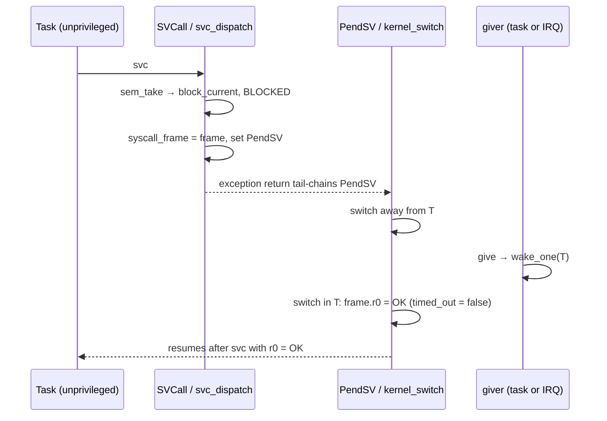

# M5: Syscalls, Unprivileged Tasks, Task Kill — Implementation Plan

> **For agentic workers:** REQUIRED SUB-SKILL: Use superpowers:subagent-driven-development (recommended) or superpowers:executing-plans to implement this plan task-by-task. Steps use checkbox (`- [ ]`) syntax for tracking.
>
> **Ownership:** Tasks 1 and 6 are Claude's (harness, review, docs). Tasks 2–5 are the **user's** (kernel core). An agent MUST NOT write the non-test parts of `task.rs`, `sched.rs`, `arch/` or `sync.rs` unless the user asks; it may explain and review.

**Goal:** Tasks run unprivileged by default and reach the kernel only through `svc`. A task that faults (illegal peripheral access, stack overflow, undefined instruction) is killed; every other task keeps running.

**Architecture:**
- **Privilege:** `kernel_switch` writes CONTROL.nPRIV for the incoming task (`Task::privileged`). Application tasks are always unprivileged; only the idle task and board tests (`Task::new_privileged`, behind the kernel's `test-hooks` feature) run privileged.
- **Syscalls:** every task-side API call executes `svc #N` with up to four `u32` args in r0–r3. The `SVCall` handler (asm, 5 lines) passes the caller's stacked exception frame to `svc_dispatch`, which reads the number from the `svc` instruction, runs the kernel side under `with_sched`, and writes the result into the stacked r0 (r1 for the high half of `now`).
- **Blocking:** the kernel side returns `BLOCKED`; the dispatcher stores the frame in `Task::syscall_frame` and pends PendSV. When the task is switched back in, `kernel_switch` writes `OK` or `TIMEOUT` (from `timed_out`) into that frame's r0, so the task resumes with its answer: one syscall, no second round trip.
- **Interrupt handlers** are privileged already: `give`, `try_send`, `try_recv`, `now`, `yield_now` detect handler mode (IPSR ≠ 0) and call the kernel side directly.
- **Generic queue:** each `Queue<T, N>` starts with `&'static QueueOps`, two functions compiled for its own `T`/`N`; the dispatcher calls them without knowing `T`.
- **Faults:** MemManage/BusFault/UsageFault get kernel handlers. Fault interrupted a task (ICSR.RETTOBASE) → log, `kill_current` (state `Dead`), switch away. Anywhere else (a handler, `main`, the idle task) → panic.
- **Critical sections:** the kernel provides the `critical-section` impl (defmt and the HAL use it). Privileged code masks interrupts with PRIMASK; an unprivileged task cannot (`cpsid` is ignored there), so it asks the kernel to raise BASEPRI.

**Tech Stack:** M4 kernel; `cortex-m` 0.7 registers (`control`, `basepri`, `primask`, `psp`, `psplim`); `critical-section` 1.2 (`restore-state-u32`); `defmt` in the kernel for the kill log.

**Spec:** `docs/superpowers/specs/2026-10-14-rtos-kernel-design.md` (section 5, milestone M5)

## Global Constraints

- Everything in the M0–M4 plans' Global Constraints still holds.
- Public API signatures unchanged. Board tests get `Task::new_privileged` (same arguments as `Task::new`), compiled only with the kernel feature `test-hooks`, which only `app` enables.
- Application tasks are always unprivileged; the idle task is privileged. Test tasks that touch core peripherals (NVIC, ICSR, SysTick) use `Task::new_privileged`.
- A killed task's mutexes stay locked (its waiters block until their timeout).
- Never block inside a critical section (BASEPRI would keep PendSV masked).
- Verified on this board with a throwaway reference (2026-10-14):
  - 44 host tests; `m5_fault` kills `rogue` (BusFault, CFSR `00008200`), `holder` (UsageFault UNDEFINSTR, `00010000`), `overflow` (UsageFault STKOF, `00100000`); the innocent task ran 10 times in 10 ms.
  - All M1–M4 board tests pass with unprivileged tasks; IRQ→task latency still 11 µs. An unprivileged `panic!` exits 1.
  - Mutants caught: tasks left privileged → `m5_fault` fails "rogue task ran on after writing SysTick"; no r0 writeback → `m3_sem` fails "interrupt give never arrived", `m4_mutex` fails; `kill_current` a no-op → host test `killed_task_never_runs_again` fails.

## Fixed interfaces

```rust
// kernel/src/task.rs
pub(crate) enum State { Ready, Running, Sleeping, Blocked, Dead }
// new Task fields:
pub(crate) privileged: bool,          // false in build; idle is privileged
pub(crate) syscall_frame: *mut u32,   // frame of the blocking syscall, else null
#[cfg(feature = "test-hooks")]
impl Task { pub fn new_privileged<const N: usize>(name: &'static str, priority: u8, entry: fn() -> !, stack: &'static Stack<N>) -> Task; }

// kernel/src/sched.rs
impl Instant { pub(crate) const fn from_ticks(ticks: u64) -> Instant; }       // no longer test-only
pub(crate) fn timeout_to_ticks(t: Option<Duration>) -> u64;  // None = u64::MAX; rounds up; Some never MAX
pub(crate) fn ticks_to_timeout(ticks: u64) -> Option<Duration>;
impl Sched { pub(crate) fn kill_current(&mut self); }       // state Dead; caller pends PendSV

// kernel/src/arch/svc.rs (new)
pub(crate) const YIELD: u8 = 0;  NOW = 1;  SLEEP_UNTIL = 2;  SLEEP = 3;
SEM_TAKE = 4;  SEM_GIVE = 5;  MUTEX_LOCK = 6;  MUTEX_UNLOCK = 7;
QUEUE_SEND = 8;  QUEUE_RECV = 9;  CS_ENTER = 10;  CS_EXIT = 11;
pub(crate) const OK: u32 = 0;  TIMEOUT: u32 = 1;  BLOCKED: u32 = 2;
pub(crate) fn svc<const N: u8>(a0: u32, a1: u32, a2: u32, a3: u32) -> (u32, u32);
pub(crate) fn in_handler() -> bool;                          // IPSR != 0
pub(crate) fn split(v: u64) -> (u32, u32);                   // (lo, hi)
pub(crate) fn from_handler(f: impl FnOnce(&mut Sched) -> u32) -> u32;
#[unsafe(no_mangle)] unsafe extern "C" fn svc_dispatch(frame: *mut u32);
// + global_asm! SVCall, + critical_section::set_impl!

// kernel/src/arch/fault.rs (new)
extern "C" fn MemoryManagement(); extern "C" fn BusFault(); extern "C" fn UsageFault();

// kernel/src/sync.rs
pub(crate) struct SemInner;  // was private
pub(crate) unsafe fn sem_take(s: &mut Sched, inner: *mut SemInner, timeout: Option<Duration>) -> u32;
pub(crate) unsafe fn sem_give(s: &mut Sched, inner: *mut SemInner) -> u32;
pub(crate) struct QueueOps {
    pub(crate) send: unsafe fn(&mut Sched, *const (), *mut (), Option<Duration>) -> u32,
    pub(crate) recv: unsafe fn(&mut Sched, *const (), *mut (), Option<Duration>) -> u32,
}
#[repr(C)] pub struct Queue<T, const N: usize> { ops: &'static QueueOps, inner: UnsafeCell<QueueInner<T, N>> }
```

Syscall argument layout (two words per `u64`, low first):

| Syscall | r0 | r1 | r2 | r3 | Result r0 (r1) |
|---|---|---|---|---|---|
| `YIELD` | | | | | OK |
| `NOW` | | | | | ticks lo (hi) |
| `SLEEP_UNTIL` | ticks lo | hi | | | OK |
| `SLEEP` | ticks lo | hi | | | OK |
| `SEM_TAKE` | `*mut SemInner` | timeout lo | hi | | OK / TIMEOUT |
| `SEM_GIVE` | `*mut SemInner` | | | | OK |
| `MUTEX_LOCK` | `*mut MutexCore` | timeout lo | hi | | OK / TIMEOUT |
| `MUTEX_UNLOCK` | `*mut MutexCore` | | | | OK |
| `QUEUE_SEND` / `RECV` | `*const Queue` | `*mut Option<T>` slot | timeout lo | hi | OK / TIMEOUT |
| `CS_ENTER` | | | | | old BASEPRI |
| `CS_EXIT` | old BASEPRI | | | | OK |

## A blocking syscall, end to end



---

### Task 1 (Claude): M5 harness

**Files:**
- `kernel/Cargo.toml`: add `critical-section = { version = "1.2", features = ["restore-state-u32"] }`, `defmt = "1"` (arm-only deps).
- `app/Cargo.toml`: drop `panic-probe` and cortex-m's `critical-section-single-core` (the kernel now provides the impl).
- `app/src/lib.rs`:
  - `use {defmt_rtt as _, kernel as _};` (binaries that never call the kernel still need its critical-section impl linked);
  - own `#[panic_handler]`: `defmt::error!` + semihosting `EXIT_FAILURE`. panic-probe ends with `udf`, which would now only kill the panicking task, and it writes SHCSR, which faults when unprivileged.
- `kernel/src/task.rs`: `for_test` sets `privileged: false`, `syscall_frame: null`.
- `kernel/src/sched/tests.rs`: append the M5 tests below.
- `app/src/bin/m5_fault.rs` (new); delete `app/src/bin/m1_overflow.rs` (its "overflow ends the run with exit 1" is exactly what M5 changes; `m5_fault` covers overflow now).
- `kernel/Cargo.toml`: `[features] test-hooks = []`; `app/Cargo.toml` enables it.
- `m1_coop` tasks (write ICSR), the `m3_sem` waiter (NVIC mask/unmask) and the `m5_fault` checker (reads SysTick) use `Task::new_privileged`.

- [ ] **Step 1: append to `kernel/src/sched/tests.rs`**

```rust
// ---- M5: syscalls and task kill ----

#[test]
fn syscall_timeouts_round_up_and_survive_the_round_trip() {
    use crate::sched::{ticks_to_timeout, timeout_to_ticks};
    assert_eq!(timeout_to_ticks(None), u64::MAX, "forever");
    assert_eq!(timeout_to_ticks(Some(Duration::ZERO)), 0, "try: never blocks");
    assert_eq!(timeout_to_ticks(Some(Duration::from_micros(1))), 1, "a wait must never end early");
    assert_eq!(timeout_to_ticks(Some(ms(5))), 5);
    assert_ne!(timeout_to_ticks(Some(Duration::MAX)), u64::MAX, "a huge timeout is not forever");
    for t in [None, Some(Duration::ZERO), Some(ms(1)), Some(ms(5))] {
        assert_eq!(ticks_to_timeout(timeout_to_ticks(t)), t);
    }
}

#[test]
fn killed_task_never_runs_again() {
    let (mut s, _, t, _own) = sched_with(&[1, 1]);
    assert_eq!(s.switch(), t[0]);
    s.kill_current();
    assert_eq!(s.switch(), t[1]);
    assert_eq!(s.switch(), t[1], "dead task was queued again");
    s.tick();
    assert_eq!(s.switch(), t[1]);
}

#[test]
fn killed_owner_leaves_its_mutex_locked() {
    let (mut s, _, t, _own) = sched_with(&[1, 2]);
    let mut m = mutex();
    assert_eq!(s.switch(), t[1]);
    s.sleep_current(at(1));
    assert_eq!(s.switch(), t[0]);
    unsafe { s.lock_current(&mut *m, None) };
    s.kill_current();
    s.switch();
    s.tick(); // the waiter wakes and tries the dead task's mutex
    assert_eq!(s.switch(), t[1]);
    assert_eq!(unsafe { s.lock_current(&mut *m, Some(ms(2))) }, Lock::Blocked);
    assert_eq!(prio(t[0]), 2, "boosting a dead owner is harmless");
    s.switch();
    s.tick();
    s.tick();
    assert!(unsafe { (*t[1]).timed_out }, "lock on a dead task's mutex must time out");
    assert_eq!(m.owner(), t[0], "mutex stays locked");
}
```

- [ ] **Step 2: `app/src/bin/m5_fault.rs`**

```rust
//! M5: tasks are unprivileged, and a fault kills only the task that caused it.
//! Three tasks fault three ways: a SysTick write (BusFault: core peripherals
//! are privileged-only), a stack overflow (UsageFault STKOF, via PSPLIM) and
//! an undefined instruction while holding a mutex (UsageFault UNDEFINSTR).
//! A privileged checker then verifies SysTick is untouched, time still runs,
//! an innocent task kept running, and the dead task's mutex stays locked.
#![no_std]
#![no_main]

use core::sync::atomic::{AtomicU32, Ordering::SeqCst};
use cortex_m::peripheral::SYST;
use kernel::{Duration, Mutex, Stack, Task};

/// Progress markers: 1 = about to fault, 2 = survived the fault (must not happen).
static ROGUE: AtomicU32 = AtomicU32::new(0);
static OVERFLOW: AtomicU32 = AtomicU32::new(0);
static HOLDER: AtomicU32 = AtomicU32::new(0);
static ALIVE: AtomicU32 = AtomicU32::new(0);
static RELOAD: AtomicU32 = AtomicU32::new(0);
static LOCK: Mutex<()> = Mutex::new(());

static STACK_ALIVE: Stack<512> = Stack::new();
static STACK_ROGUE: Stack<512> = Stack::new();
static STACK_OVERFLOW: Stack<256> = Stack::new();
static STACK_HOLDER: Stack<512> = Stack::new();
static STACK_CHECKER: Stack<1024> = Stack::new();

fn alive() -> ! {
    loop {
        ALIVE.fetch_add(1, SeqCst);
        kernel::sleep(Duration::from_millis(1));
    }
}

fn rogue() -> ! {
    ROGUE.store(1, SeqCst);
    // SAFETY: deliberately illegal: SysTick belongs to the kernel.
    unsafe { (*SYST::PTR).rvr.write(1000) };
    ROGUE.store(2, SeqCst);
    loop {}
}

#[inline(never)]
fn recurse(n: u32) -> u32 {
    let buf = core::hint::black_box([n; 16]);
    if n == 0 { 0 } else { recurse(n - 1).wrapping_add(buf[3]) }
}

fn overflow() -> ! {
    kernel::sleep(Duration::from_millis(2));
    OVERFLOW.store(1, SeqCst);
    core::hint::black_box(recurse(1000));
    OVERFLOW.store(2, SeqCst);
    loop {}
}

fn holder() -> ! {
    let _guard = LOCK.lock(None).unwrap();
    HOLDER.store(1, SeqCst);
    cortex_m::asm::udf();
}

fn checker() -> ! {
    kernel::sleep(Duration::from_millis(20));
    assert_eq!(ROGUE.load(SeqCst), 1, "rogue task ran on after writing SysTick: not unprivileged, or not killed");
    assert_eq!(OVERFLOW.load(SeqCst), 1, "overflowing task ran on");
    assert_eq!(HOLDER.load(SeqCst), 1, "faulting holder ran on");
    // SAFETY: this task is privileged; reading SysTick is allowed.
    let reload = unsafe { (*SYST::PTR).rvr.read() };
    assert_eq!(reload, RELOAD.load(SeqCst), "SysTick reload was changed");

    let (t0, a0) = (kernel::now(), ALIVE.load(SeqCst));
    kernel::sleep(Duration::from_millis(10));
    assert_eq!(kernel::now() - t0, Duration::from_millis(10), "time stopped");
    let ran = ALIVE.load(SeqCst) - a0;
    assert!(ran >= 9, "innocent task ran only {} times in 10 ms", ran);

    assert!(LOCK.lock(Some(Duration::from_millis(5))).is_err(), "dead task's mutex was released");
    defmt::info!("3 tasks killed; SysTick intact; innocent task ran {} times in 10 ms", ran);
    app::exit_ok()
}

#[app::entry]
fn main() -> ! {
    let b = app::init();
    RELOAD.store(b.sys_hz / 1000 - 1, SeqCst);
    let mut tasks = [
        Task::new("alive", 1, alive, &STACK_ALIVE),
        Task::new("rogue", 2, rogue, &STACK_ROGUE),
        Task::new("overflow", 2, overflow, &STACK_OVERFLOW),
        Task::new("holder", 2, holder, &STACK_HOLDER),
        Task::new_privileged("checker", 3, checker, &STACK_CHECKER),
    ];
    kernel::start(&mut tasks, b.sys_hz)
}
```

- [ ] **Step 3: commit the red harness**

---

### Task 2 (User): task state and kill — `task.rs`, `sched.rs`

**Goal:** 44 host tests pass.

- `State::Dead`; fields `privileged`, `syscall_frame`; `Task::idle` sets `privileged: true`.
- `#[cfg(feature = "test-hooks")] pub fn new_privileged(..)`: `Task::new(..)` with `privileged = true`. A feature, not `#[cfg(test)]`: board tests are in the `app` crate, where the kernel is compiled without `cfg(test)`.
- `Instant::from_ticks` loses `#[cfg(test)]` (the dispatcher builds `Instant`s from syscall words).
- `timeout_to_ticks` / `ticks_to_timeout`: reuse `to_ticks` (rounds up). Clamp `Some` to `u64::MAX - 1` so a huge timeout never turns into "forever".
- `kill_current`: assert there is a current task, set it `Dead`. Nothing else: the running task is in no list, and `switch` only re-queues a `Running` task.
- `set_priority`: `Dead` joins the "just set it" arm (`killed_owner_leaves_its_mutex_locked` boosts a dead owner).

---

### Task 3 (User): syscall entry and privilege — `arch/svc.rs`, `arch/mod.rs`

**Goal:** builds; with Tasks 4 and 5 the board tests run.

1. `svc::<N>(a0..a3)`: `asm!("svc {n}", n = const N, inlateout("r0") a0 => r0, inlateout("r1") a1 => r1, in("r2") a2, in("r3") a3, options(nostack))`. No `nomem`: the kernel writes queue slots.
2. `in_handler`: `mrs {}, ipsr` (readable unprivileged; `SCB::vect_active` reads ICSR, which faults unprivileged).
3. `SVCall` in `global_asm!`: EXC_RETURN bit 2 picks the stack (`tst lr, #4; ite eq; mrseq r0, msp; mrsne r0, psp`), then `b svc_dispatch`. `b`, not `bl`: lr keeps EXC_RETURN, so `svc_dispatch` returning *is* the exception return.
4. `svc_dispatch(frame)`:
   - number: `*((*frame.add(6)) as *const u8).sub(2)` (stacked pc points past the 2-byte `svc`; its low byte is the immediate);
   - args `frame[0..4]`; everything inside one `with_sched`; result into `frame[0]` (`NOW` also writes `frame[1]`);
   - after the call (`finish`): `BLOCKED` → `(*cur).syscall_frame = frame`; then pend PendSV if the caller is no longer `Running` (slept, blocked, died) or `should_switch()`;
   - unknown number → `kill_current`.
5. `from_handler(f)`: `with_sched`, run `f`, assert not `BLOCKED`, pend PendSV if `should_switch()`.
6. `kernel_switch`, after `switch()`:
   - `syscall_frame` non-null → write `TIMEOUT` if `timed_out` else `OK` into it, clear it;
   - read-modify-write CONTROL: only nPRIV (`control::read()`, `set_npriv`, `control::write`). The `bx lr` exception return makes it take effect.
7. Public API: `yield_now` and `now` check `in_handler()` (direct path) else `svc`; `sleep_until`/`sleep` are `svc` only (`SLEEP` passes `timeout_to_ticks(Some(d))`, the kernel adds it to `now` itself).

**Hints**
- Why the frame and not registers: the hardware pushed r0–r3 on entry and pops them on return, so writing `frame[0]` *is* setting the caller's return value.
- Why write the result at switch-in: every wake path (`wake_one`, tick timeout, mutex handover) already sets or clears `timed_out`; one place in `kernel_switch` turns that into r0.
- `svc` from a handler at priority ≥ SVCall's (0) escalates to HardFault. That is why handler-mode callers take the direct path.

---

### Task 4 (User): sync objects through syscalls — `sync.rs`

**Goal:** `m3_sem`, `m3_queue`, `m4_inversion`, `m4_mutex` pass with unprivileged tasks.

- Move each `with_sched` closure body into a kernel-side function returning `OK`/`TIMEOUT`/`BLOCKED`: `sem_take`, `sem_give`, `Queue::send_raw`, `Queue::recv_raw`. They no longer yield or return a "switch?" flag: the dispatcher's `finish` decides.
- `Queue`:
  - `#[repr(C)]` with `ops` first;
  - `const OPS: QueueOps = QueueOps { send: Self::send_raw, recv: Self::recv_raw }` and `ops: &Self::OPS` in `new` (a reference to a constant is promoted to `'static`);
  - the dispatcher reads `*(q as *const &'static QueueOps)`.
- `send_raw` takes the item from the caller's slot (`*mut Option<T>`), and puts it back if it could not be delivered. `send` returns `Err(slot.take())` on `TIMEOUT`.
- Wrappers: `take`/`lock`/`send`/`recv` encode the timeout with `timeout_to_ticks` + `split`; `give`/`try_*` from a handler use `from_handler`; `Mutex::lock` asserts `!in_handler()`; `MutexGuard::drop` makes `MUTEX_UNLOCK`.

---

### Task 5 (User): faults and critical sections — `arch/fault.rs`, `arch/svc.rs`, `start`

**Goal:** `m5_fault` exits 0; all M1–M4 board tests still pass.

- `start`: `p.SCB.enable(Exception::MemoryManagement | BusFault | UsageFault)`, one call each (else they escalate to HardFault).
- `fault(kind)`:
  - read CFSR (`0xE000_ED28`) and ICSR.RETTOBASE (bit 11 of `0xE000_ED04`: this exception is the only active one, so it interrupted thread mode);
  - not from thread mode, no current task, or the idle task → `panic!` with kind and CFSR;
  - else `basepri::write(0)` (the task may have died inside its critical section), `defmt::error!("task '{}' killed: {} (CFSR {=u32:08x})", ..)`, write CFSR back (write-1-to-clear), `kill_current`;
  - `psplim::write(0)` then `psp::write(DUMMY top)`, `set_pendsv`.
- `critical_section::Impl` (in `svc.rs`):
  - acquire: unprivileged thread (`!in_handler()` and `control::read().npriv()` unprivileged) → `0x100 | svc(CS_ENTER)`, else the PRIMASK path (`was_enabled`, `interrupt::disable`);
  - release: bit 8 → `svc(CS_EXIT, state & 0xFF)`, else re-enable if bit 0;
  - kernel side: `CS_ENTER` returns the old BASEPRI and writes `0x80` (masks SysTick and PendSV); `CS_EXIT` restores it.

**Hints**
- Why move PSP: the fault returns by tail-chaining PendSV, which saves the dead task's registers below PSP. After a stack overflow PSP sits at the limit, so those stores would land in whatever memory lies below the stack. `DUMMY` is scratch space; PSPLIM goes to 0 first so the new PSP is never "below the limit".
- Why BASEPRI and not PRIMASK for tasks: leaving the critical section needs another `svc`, and an `svc` with PRIMASK set escalates to HardFault. BASEPRI 0x80 still lets SVCall (priority 0) in. defmt needs this: with `cpsid` ignored, a task preempted mid-log by another logging task makes defmt panic ("taken reentrantly").
- Device interrupts at priority 0 are not masked by a task's critical section. None of the tests log from an interrupt handler.

**Verify**
- `m5_fault` → three `task '…' killed` lines, `3 tasks killed; SysTick intact; …`, `TEST PASS`.
- If it fails with "rogue task ran on after writing SysTick", CONTROL.nPRIV is not reaching the task.
- If `m3_sem` hangs or fails "interrupt give never arrived", the switch-in r0 writeback is missing.

---

### Task 6 (Claude): review, spec/README, commit
