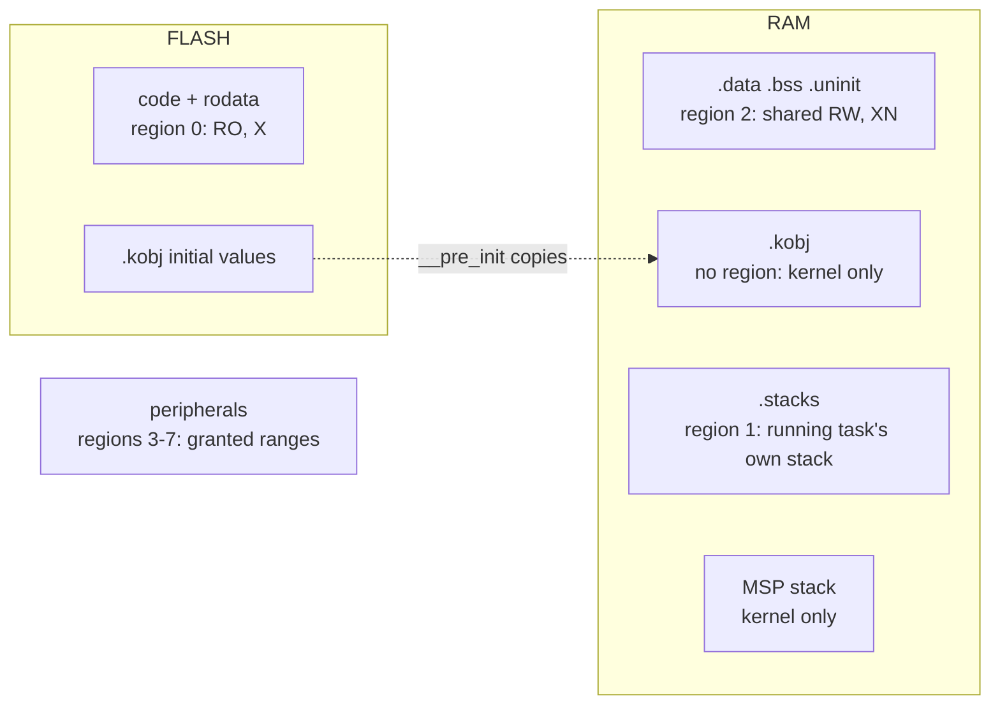

# M6: MPU Isolation — Implementation Plan

> **For agentic workers:** REQUIRED SUB-SKILL: Use superpowers:subagent-driven-development (recommended) or superpowers:executing-plans to implement this plan task-by-task. Steps use checkbox (`- [ ]`) syntax for tracking.
>
> **Ownership:** Tasks 1 and 6 are Claude's (harness, review, docs). Tasks 2–5 are the **user's** (kernel core). An agent MUST NOT write the non-test parts of `region.rs`, `task.rs`, `arch/` or `sync/` unless the user asks; it may explain and review.

**Goal:** An unprivileged task can touch only flash, its own stack, the shared RAM, and the peripherals it was granted. Anything else (another task's stack, kernel state, an ungranted peripheral, executing RAM) faults and kills only that task. Syscalls refuse kernel-object pointers that are not real kernel objects, and queue slots outside the caller's stack.

**Architecture:**
- **Memory layout (linker):** RAM is `.data | .bss | .uninit` (shared: plain statics, defmt's buffer) then `.kobj` (kernel objects, kernel only) then `.stacks` (task stacks). `.kobj` has initial values but lies outside the range cortex-m-rt copies, so the kernel's `__pre_init` copies it from flash.
- **Declaring objects:** `kernel::stack!`, `semaphore!`, `queue!`, `mutex!` put each object in its section. `Mutex` splits: lock state (`RawMutex`) in `.kobj`, data (`MutexData<T>`) in shared RAM, and `Mutex<T>` is two `&'static` references.
- **MPU (8 regions, PRIVDEFENA):** 0 flash (read-only, executable), 2 shared RAM (`[__sdata, __skobj)`, read/write, execute-never), set once in `start`. 1 own stack and 3–7 granted peripherals, loaded in `kernel_switch` for every task. Privileged code (kernel, handlers, idle, test tasks) also sees the default map, so it reaches `.kobj`, every stack, and every peripheral.
- **Region encoding** (`region.rs`, pure, host-tested): `Region { rbar, rlar }` for code / data / device memory.
- **Pointer checks (`svc_dispatch`):** the object argument of sync syscalls must lie in `.kobj` (aligned, whole object); a queue slot must lie in the caller's stack (unprivileged callers). Otherwise: log and kill the caller.
- **Kill path change:** returning from a fault handler, the core unstacks a frame from PSP *before* it takes the pending PendSV, with the dead task's unprivileged rights. PSP therefore stays inside the dead task's own stack (32 words above its limit) with a clean frame pointing at a parking loop, instead of `DUMMY` (now in `.kobj`).

**Tech Stack:** M5 kernel; ARMv8-M PMSA (MPU_CTRL/RNR/RBAR/RLAR/MAIR0); cortex-m-rt `__pre_init` and `INSERT AFTER .uninit`.

**Spec:** `docs/superpowers/specs/2026-10-14-rtos-kernel-design.md` (section 5, milestone M6)

## Global Constraints

- Everything in the M0–M5 plans' Global Constraints still holds.
- Stacks, semaphores, queues and mutexes are declared with the kernel macros. `start` panics on a stack outside `.stacks`; syscalls kill a task that passes an object outside `.kobj`.
- Stack sizes: a multiple of 8 words (32 bytes, the MPU granule) and at least 64 words; compile-time asserts in `Stack::new`.
- Peripheral ranges: 32-byte aligned base and length, at most 5 per task.
- An immutable `static` lands in flash (readable and executable by every task); `static mut`, atomics and `UnsafeCell` statics land in shared RAM.
- Verified on this board with a throwaway reference (2026-10-14):
  - 52 host tests. `m6_mpu`: `bad_stack`, `bad_kernel`, `bad_periph` killed by MemManage (CFSR `00000082`, data access violation), `bad_exec` by MemManage (`00000001`, instruction fetch from execute-never RAM), `bad_object` killed by the syscall check; the granted task read SIO; the innocent task ran 10 times in 10 ms.
  - All M1–M5 board tests pass (IRQ→task latency 13 µs, from 12); `m2_blinky` toggles GP15 with its SIO grant.
  - Mutants caught: MPU never enabled → `m6_mpu` fails "bad_stack ran past its bad access"; object check always true → "bad_object ran past its bad access"; region limit off by one block → host test `limit_is_the_last_32_byte_block_inclusive` fails.
  - Found while building it: with `DUMMY` in `.kobj`, the old kill path looped forever on MUNSTKERR (`00000008`), because of the unstack-before-PendSV behaviour described above.

## Fixed interfaces

```rust
// kernel/src/region.rs (new, pure)
pub(crate) const PERIPHERAL_REGIONS: usize = 5;
pub(crate) const MAIR0: u32 = 0x04 << 8 | 0xFF;   // attr 0 normal write-back, attr 1 Device-nGnRE
#[derive(Clone, Copy, PartialEq, Eq, Debug)]
pub(crate) struct Region { pub(crate) rbar: u32, pub(crate) rlar: u32 }
impl Region {
    pub(crate) const DISABLED: Region;                       // rbar 0, rlar 0
    pub(crate) fn code(base: usize, len: usize) -> Region;   // RO any, executable, attr 0
    pub(crate) fn data(base: usize, len: usize) -> Region;   // RW any, XN, attr 0
    pub(crate) fn device(base: usize, len: usize) -> Region; // RW any, XN, attr 1
}   // panics "MPU region must be 32-byte aligned and non-empty"

// kernel/src/task.rs
pub(crate) stack_end: *mut u32;                            // one past the last word
pub(crate) peripherals: [Region; PERIPHERAL_REGIONS];      // DISABLED when unused
impl Task {
    pub fn with_peripheral(self, base: usize, len: usize) -> Task; // "at most 5 peripheral ranges"
    pub(crate) fn stack_contains(&self, p: usize, len: usize) -> bool;
}

// kernel/src/arch/mpu.rs (new)
pub(crate) unsafe fn init();          // MAIR0, regions 0 and 2, CTRL = ENABLE | PRIVDEFENA
pub(crate) unsafe fn load(t: &Task);  // regions 1 and 3..=7

// kernel/src/arch/mod.rs
pub(crate) fn in_kobj(p: usize, len: usize) -> bool;
// SCHED, IDLE, DUMMY: #[unsafe(link_section = ".kobj")]; IDLE_STACK: crate::stack!
// global_asm! __pre_init: copy [__skobj, __ekobj) from __sikobj

// kernel/src/sync
pub(crate) struct QueueOps { send, recv, pub(crate) slot_size: usize }
pub struct Mutex<T: 'static> { core: &'static RawMutex, data: &'static MutexData<T> }
#[doc(hidden)] pub struct RawMutex(UnsafeCell<MutexCore>);   impl RawMutex { pub const fn new() -> Self; }
#[doc(hidden)] pub struct MutexData<T>(UnsafeCell<T>);       impl<T> MutexData<T> { pub const fn new(v: T) -> Self; }
impl<T> Mutex<T> { #[doc(hidden)] pub const fn from_parts(core: &'static RawMutex, data: &'static MutexData<T>) -> Self; }
// lib.rs: #[doc(hidden)] pub use sync::{MutexData, RawMutex};  (Mutex::new is gone)
```

Linker symbols (from `app/memory.x`): `__sdata`, `__skobj`, `__ekobj`, `__sikobj`, `__sstacks`, `__estacks`, `__flash_start`, `__flash_end`.

## Memory map



---

### Task 1 (Claude): M6 harness

**Files:**
- `app/memory.x`: the `.kobj` / `.stacks` sections and symbols (below).
- `kernel/src/macros.rs` (new) + `mod macros;` in `lib.rs`; `mod region;` in `lib.rs`; `#[doc(hidden)] pub use sync::{MutexData, RawMutex};`.
- `kernel/src/region/tests.rs` (new), `kernel/src/task/tests.rs` (append), `Task::for_test` sets `stack_end: null`, `peripherals: [Region::DISABLED; 5]`.
- Every board binary: statics → macros; `m2_sleep` grants TIMER0, `m1_blinky` SIO + TIMER0, `m2_blinky` SIO. `app/src/lib.rs`: `pub use rp235x_hal as hal;`.
- `app/src/bin/m6_mpu.rs` (new).

- [ ] **Step 1: `app/memory.x`** (appended before `PROVIDE(start_to_end`)

```text
/* ### Kernel memory protection (M6)
 *
 * RAM order: .data | .bss | .uninit  = shared RAM, every task may use it
 *            .kobj                    = kernel objects, kernel only
 *            .stacks                  = task stacks, each task only its own
 * The MPU's shared region is [__sdata, __skobj), so both sections must come
 * after everything shared and be 32-byte aligned (MPU granule).
 * .kobj has initial values; the kernel's __pre_init copies them from flash.
 */
SECTIONS {
    .kobj : ALIGN(32)
    {
        __skobj = .;
        *(.kobj .kobj.*);
        . = ALIGN(32);
        __ekobj = .;
    } > RAM AT>FLASH
    __sikobj = LOADADDR(.kobj);

    .stacks (NOLOAD) : ALIGN(32)
    {
        __sstacks = .;
        *(.stacks .stacks.*);
        . = ALIGN(32);
        __estacks = .;
    } > RAM
} INSERT AFTER .uninit;

__flash_start = ORIGIN(FLASH);
__flash_end = ORIGIN(FLASH) + LENGTH(FLASH);
ASSERT(__sdata % 32 == 0, "shared RAM must start 32-byte aligned for the MPU");

```

- [ ] **Step 2: `kernel/src/macros.rs`**

```rust
//! Declaring kernel objects. Each macro puts the object in the linker section
//! the MPU setup expects; `kernel::start` and the syscalls refuse objects
//! found anywhere else.

/// A task stack of `$words` 32-bit words (a multiple of 8), in `.stacks`.
///
/// `kernel::stack!(STACK_A, 512);`
#[macro_export]
macro_rules! stack {
    ($vis:vis $name:ident, $words:expr) => {
        #[unsafe(link_section = ".stacks")]
        $vis static $name: $crate::Stack<$words> = $crate::Stack::new();
    };
}

/// A counting semaphore in `.kobj`.
///
/// `kernel::semaphore!(DONE, 0);`
#[macro_export]
macro_rules! semaphore {
    ($vis:vis $name:ident, $count:expr) => {
        #[unsafe(link_section = ".kobj")]
        $vis static $name: $crate::Semaphore = $crate::Semaphore::new($count);
    };
}

/// A queue of up to `$n` items of type `$t`, in `.kobj`.
///
/// `kernel::queue!(Q: u32, 4);`
#[macro_export]
macro_rules! queue {
    ($vis:vis $name:ident: $t:ty, $n:expr) => {
        #[unsafe(link_section = ".kobj")]
        $vis static $name: $crate::Queue<$t, $n> = $crate::Queue::new();
    };
}

/// A mutex around a `$t`: lock state in `.kobj`, data in shared RAM.
///
/// `kernel::mutex!(COUNTER: u32 = 0);`
#[macro_export]
macro_rules! mutex {
    ($vis:vis $name:ident: $t:ty = $init:expr) => {
        $vis static $name: $crate::Mutex<$t> = {
            #[unsafe(link_section = ".kobj")]
            static CORE: $crate::RawMutex = $crate::RawMutex::new();
            static DATA: $crate::MutexData<$t> = $crate::MutexData::new($init);
            $crate::Mutex::from_parts(&CORE, &DATA)
        };
    };
}
```

- [ ] **Step 3: `kernel/src/region/tests.rs`**

```rust
//! Host tests for MPU region encoding. Run: `cargo ktest`.
use super::*;

#[test]
fn limit_is_the_last_32_byte_block_inclusive() {
    let r = Region::data(0x2000_0000, 0x400);
    assert_eq!(r.rbar & !0x1F, 0x2000_0000);
    assert_eq!(r.rlar & !0x1F, 0x2000_03E0, "a 1 KiB region ends at block 0x3E0, not 0x400");
    let one = Region::data(0x2000_0040, 32);
    assert_eq!(one.rlar & !0x1F, 0x2000_0040, "a single block: limit == base");
}

#[test]
fn access_rules_per_kind() {
    let code = Region::code(0x1000_0000, 0x1000);
    assert_eq!(code.rbar & 0x7, 0b110, "flash: read-only for everyone, executable");
    let data = Region::data(0x2000_0000, 0x100);
    assert_eq!(data.rbar & 0x7, 0b011, "RAM: read/write for everyone, execute-never");
    let dev = Region::device(0xD000_0000, 0x100);
    assert_eq!(dev.rbar & 0x7, 0b011, "peripheral: read/write, execute-never");
    assert_eq!(code.rlar & 0xF, 0b0001, "normal memory (attr 0), enabled");
    assert_eq!(dev.rlar & 0xF, 0b0011, "device memory (attr 1), enabled");
    assert_eq!(MAIR0 & 0xFF, 0xFF, "attr 0: normal write-back");
    assert_eq!(MAIR0 >> 8 & 0xFF, 0x04, "attr 1: Device-nGnRE");
}

#[test]
fn disabled_region_is_not_enabled() {
    assert_eq!(Region::DISABLED.rlar & EN, 0);
}

#[test]
#[should_panic(expected = "32-byte aligned")]
fn unaligned_base_is_rejected() {
    Region::device(0xD000_0010, 0x100);
}

#[test]
#[should_panic(expected = "32-byte aligned")]
fn unaligned_length_is_rejected() {
    Region::device(0xD000_0000, 0x110);
}
```

- [ ] **Step 4: append to `kernel/src/task/tests.rs`**

```rust
// ---- M6: peripheral grants and stack bounds ----

fn task_with_stack(lo: usize, words: usize) -> Task {
    let mut t = Task::for_test(1);
    t.stack_limit = lo as *mut u32;
    t.stack_end = (lo + 4 * words) as *mut u32;
    t
}

#[test]
fn granted_peripherals_fill_the_region_slots_in_order() {
    let t = Task::for_test(1).with_peripheral(0xD000_0000, 0x100).with_peripheral(0x400B_0000, 0x40);
    assert_eq!(t.peripherals[0], Region::device(0xD000_0000, 0x100));
    assert_eq!(t.peripherals[1], Region::device(0x400B_0000, 0x40));
    assert_eq!(t.peripherals[2], Region::DISABLED);
}

#[test]
#[should_panic(expected = "at most 5")]
fn a_sixth_peripheral_is_rejected() {
    let mut t = Task::for_test(1);
    for i in 0..6 {
        t = t.with_peripheral(0x4000_0000 + i * 0x1000, 0x100);
    }
}

#[test]
fn stack_contains_checks_both_ends() {
    let t = task_with_stack(0x2001_0000, 64); // 0x2001_0000..0x2001_0100
    assert!(t.stack_contains(0x2001_0000, 8), "first bytes");
    assert!(t.stack_contains(0x2001_00F8, 8), "last bytes");
    assert!(!t.stack_contains(0x2001_00FC, 8), "runs past the end");
    assert!(!t.stack_contains(0x2000_FFFC, 8), "starts below the stack");
    assert!(!t.stack_contains(usize::MAX - 4, 8), "wraps around the address space");
}
```

- [ ] **Step 5: `app/src/bin/m6_mpu.rs`**

```rust
//! M6: the MPU confines each unprivileged task to flash, its own stack, the
//! shared RAM and the peripherals it was granted. Each `bad_*` task breaks one
//! rule and must die at that exact access; the others must not notice.
//!
//! | task          | does                                   | expect            |
//! |---------------|----------------------------------------|-------------------|
//! | `alive`       | counts in shared RAM, sleeps           | keeps running     |
//! | `granted`     | reads SIO (granted)                    | survives          |
//! | `bad_stack`   | reads `alive`'s stack                  | MemManage, killed |
//! | `bad_kernel`  | reads a semaphore in `.kobj`           | MemManage, killed |
//! | `bad_periph`  | reads SIO (not granted)                | MemManage, killed |
//! | `bad_exec`    | jumps into shared RAM (execute-never)  | MemManage, killed |
//! | `bad_object`  | gives a fake semaphore in shared RAM   | syscall refuses, killed |
//!
//! A privileged checker then reads the markers: 1 = reached the bad access,
//! 2 = ran past it (a hole in the protection).
#![no_std]
#![no_main]

use core::sync::atomic::{AtomicU32, Ordering::SeqCst};
use kernel::{Duration, Semaphore, Task};

static ALIVE: AtomicU32 = AtomicU32::new(0);
static GRANTED: AtomicU32 = AtomicU32::new(0);
static BAD_STACK: AtomicU32 = AtomicU32::new(0);
static BAD_KERNEL: AtomicU32 = AtomicU32::new(0);
static BAD_PERIPH: AtomicU32 = AtomicU32::new(0);
static BAD_EXEC: AtomicU32 = AtomicU32::new(0);
static BAD_OBJECT: AtomicU32 = AtomicU32::new(0);
/// `bx lr` (0x4770): valid code, but RAM is execute-never. `static mut` puts it
/// in RAM (`.data`); a plain `static` would land in flash, which may execute.
static mut RAM_CODE: [u16; 2] = [0x4770, 0x4770];
/// Lookalike of a semaphore in shared RAM, where any task could write it.
static mut FAKE_SEM: [u32; 8] = [0; 8];

kernel::semaphore!(REAL_SEM, 0);
kernel::stack!(STACK_ALIVE, 256);
kernel::stack!(STACK_GRANTED, 256);
kernel::stack!(STACK_BAD_STACK, 256);
kernel::stack!(STACK_BAD_KERNEL, 256);
kernel::stack!(STACK_BAD_PERIPH, 256);
kernel::stack!(STACK_BAD_EXEC, 256);
kernel::stack!(STACK_BAD_OBJECT, 256);
kernel::stack!(STACK_CHECKER, 1024);

/// SIO block (GPIO, CPUID). Its address is fixed in the RP2350 memory map.
const SIO: usize = 0xD000_0000;

fn park() -> ! {
    loop {
        kernel::sleep(Duration::from_secs(1));
    }
}

fn alive() -> ! {
    loop {
        ALIVE.fetch_add(1, SeqCst);
        kernel::sleep(Duration::from_millis(1));
    }
}

fn granted() -> ! {
    // SIO CPUID: 0 on core 0. Allowed: SIO is in this task's regions.
    let cpuid = unsafe { (SIO as *const u32).read_volatile() };
    GRANTED.store(if cpuid == 0 { 2 } else { 3 }, SeqCst);
    park()
}

fn bad_stack() -> ! {
    BAD_STACK.store(1, SeqCst);
    let other = STACK_ALIVE_ADDR.load(SeqCst) as *const u32;
    core::hint::black_box(unsafe { other.read_volatile() });
    BAD_STACK.store(2, SeqCst);
    park()
}

fn bad_kernel() -> ! {
    BAD_KERNEL.store(1, SeqCst);
    let sem = &REAL_SEM as *const Semaphore as *const u32;
    core::hint::black_box(unsafe { sem.read_volatile() });
    BAD_KERNEL.store(2, SeqCst);
    park()
}

fn bad_periph() -> ! {
    BAD_PERIPH.store(1, SeqCst);
    core::hint::black_box(unsafe { (SIO as *const u32).read_volatile() });
    BAD_PERIPH.store(2, SeqCst);
    park()
}

fn bad_exec() -> ! {
    BAD_EXEC.store(1, SeqCst);
    // Thumb: bit 0 set. Executing from an XN region faults on the fetch.
    let code = &raw const RAM_CODE as usize;
    let f: extern "C" fn() = unsafe { core::mem::transmute(code | 1) };
    f();
    BAD_EXEC.store(2, SeqCst);
    park()
}

fn bad_object() -> ! {
    BAD_OBJECT.store(1, SeqCst);
    // SAFETY: deliberately not: a forged object. The kernel must refuse it.
    let fake: &Semaphore = unsafe { &*(&raw const FAKE_SEM as *const Semaphore) };
    fake.give();
    BAD_OBJECT.store(2, SeqCst);
    park()
}

/// Address of `alive`'s stack, published by the privileged `main`.
static STACK_ALIVE_ADDR: AtomicU32 = AtomicU32::new(0);

fn checker() -> ! {
    kernel::sleep(Duration::from_millis(20));
    assert_eq!(GRANTED.load(SeqCst), 2, "granted task could not read its peripheral");
    for (name, m) in [
        ("bad_stack", &BAD_STACK),
        ("bad_kernel", &BAD_KERNEL),
        ("bad_periph", &BAD_PERIPH),
        ("bad_exec", &BAD_EXEC),
        ("bad_object", &BAD_OBJECT),
    ] {
        let v = m.load(SeqCst);
        assert!(v != 0, "{} never ran", name);
        assert!(v != 2, "{} ran past its bad access: not protected", name);
    }
    let a0 = ALIVE.load(SeqCst);
    kernel::sleep(Duration::from_millis(10));
    let ran = ALIVE.load(SeqCst) - a0;
    assert!(ran >= 9, "innocent task ran only {} times in 10 ms", ran);
    defmt::info!("5 tasks killed at their bad access; granted read ok; innocent task ran {} times", ran);
    app::exit_ok()
}

#[app::entry]
fn main() -> ! {
    let b = app::init();
    STACK_ALIVE_ADDR.store(&STACK_ALIVE as *const _ as u32, SeqCst);
    let mut tasks = [
        Task::new("alive", 1, alive, &STACK_ALIVE),
        Task::new("granted", 2, granted, &STACK_GRANTED).with_peripheral(SIO, 0x200),
        Task::new("bad_stack", 2, bad_stack, &STACK_BAD_STACK),
        Task::new("bad_kernel", 2, bad_kernel, &STACK_BAD_KERNEL),
        Task::new("bad_periph", 2, bad_periph, &STACK_BAD_PERIPH),
        Task::new("bad_exec", 2, bad_exec, &STACK_BAD_EXEC),
        Task::new("bad_object", 2, bad_object, &STACK_BAD_OBJECT),
        Task::new_privileged("checker", 3, checker, &STACK_CHECKER),
    ];
    kernel::start(&mut tasks, b.sys_hz)
}
```

- [ ] **Step 6: commit the red harness**

---

### Task 2 (User): region encoding and task fields — `region.rs`, `task.rs`

**Goal:** all 52 host tests pass.

- `Region::encode(base, len, access, attr)`: assert alignment; `rbar = base | access`; `rlar = (base + len - 32) | attr | EN`. The limit field holds the *last* 32-byte block (inclusive), hence `- 32`.
- AP bits [2:1]: `0b01` read/write any privilege, `0b11` read-only any privilege. XN is bit 0. AttrIndx is RLAR bits [3:1].
- `Stack::new`: `const { assert!(N % 8 == 0, ..) }` and `const { assert!(N >= 64, ..) }` (64: room for the kill path's parked frame).
- `build` sets `stack_end: base.add(N)` and all peripherals `DISABLED`.
- `with_peripheral`: first `DISABLED` slot ← `Region::device(base, len)`; none left → panic.
- `stack_contains`: `p >= limit && p + len <= end`, with `checked_add` so a pointer near `usize::MAX` cannot wrap around.

---

### Task 3 (User): MPU and memory layout — `arch/mpu.rs`, `arch/mod.rs`

**Goal:** builds; with Tasks 4–5, `m6_mpu` passes.

1. **`mpu.rs`:** registers `CTRL 0xE000_ED94`, `RNR 0xE000_ED98`, `RBAR 0xE000_ED9C`, `RLAR 0xE000_EDA0`, `MAIR0 0xE000_EDC0`.
   - `set(n, r)`: `RNR = n; RLAR = 0; RBAR = r.rbar; RLAR = r.rlar`. Disabling first means a half-written region never spans a mix of old and new bounds (overlapping regions fault, even for privileged code).
   - `init`: MAIR0; region 0 = `code(__flash_start, len)`, region 2 = `data(__sdata, __skobj - __sdata)`; `CTRL = ENABLE | PRIVDEFENA`; `dsb; isb`.
   - `load(t)`: region 1 = `data(t.stack_limit, len)`, regions 3..=7 = `t.peripherals`; `dsb`.
2. **`mod.rs`:**
   - `SCHED`, `IDLE`, `DUMMY` get `#[unsafe(link_section = ".kobj")]`; `IDLE_STACK` becomes `crate::stack!(IDLE_STACK, 128)`.
   - `__pre_init` in `global_asm!`: copy word by word from `__sikobj` to `[__skobj, __ekobj)`. It runs before RAM init, so plain asm, no Rust.
   - `in_kobj(p, len)`: like `stack_contains`, against `__skobj..__ekobj`.
   - `start`: assert every task's `stack_limit..stack_end` lies in `__sstacks..__estacks` ("task stack not in .stacks: declare it with kernel::stack!"), and call `mpu::init()` after enabling the fault handlers.
   - `kernel_switch`: `mpu::load(&*next)` after writing CONTROL.

**Hints**
- Taking a linker symbol's address: `unsafe extern "C" { static __skobj: u8; }`, then `&raw const __skobj as usize` (no `unsafe` needed for `&raw const`).
- PRIVDEFENA is what keeps the kernel working: without it, privileged code would also be limited to the 8 regions.

---

### Task 4 (User): pointer checks and the Mutex split — `arch/svc.rs`, `sync/`

**Goal:** `m6_mpu`'s `bad_object` is killed by the syscall; M3/M4 tests pass with macro-declared objects.

- `object_ok(p, sys)`: `p % 4 == 0 && in_kobj(p, size)`, with size `SemInner` / `MutexCore` / `&QueueOps` by syscall. A guarded arm before the real ones: `Sys::SemTake | .. | Sys::QueueRecv if !object_ok(..) => { log; kill_current }`.
- Queue: check `q` first, only then read its `ops`. Then the slot: if the caller is unprivileged and `!stack_contains(slot, ops.slot_size)` → log, kill, and skip the op.
- `QueueOps::slot_size = size_of::<Option<T>>()`.
- `Mutex` split as in the fixed interfaces; `lock`/guard use `self.core.0.get()` and `self.data.0.get()`.

**Hints**
- Why the object check matters: a task that forges a `Queue` in its own RAM could make the privileged dispatcher call any function pointer. `.kobj` is not writable by tasks, so a pointer inside it is a real, kernel-initialized object.
- After `kill_current` in the dispatcher, don't `return` out of the closure: `finish` must still run so PendSV gets pended.

---

### Task 5 (User): the kill path under the MPU — `arch/fault.rs`

**Goal:** `m6_mpu` and `m5_fault` pass.

Replace "PSP = top of `DUMMY`" with:
- `frame = stack_limit + 32 words`; zero 26 words there; `frame[6] = park & !1` (pc), `frame[7] = 0x0100_0000` (xPSR, Thumb);
- `psplim = stack_limit`, `psp = frame`, pend PendSV;
- `fn park() -> ! { loop { wfi() } }`.

**Why**
- Leaving the handler, the core unstacks from PSP before taking PendSV, as the dead task (unprivileged). `DUMMY` is in `.kobj` now, so that read faults, and the same fault repeats forever (seen in the reference: an endless MUNSTKERR, `00000008`).
- Inside its own stack the read is allowed, and PendSV switches away before `park` ever runs.
- 32 words of room below the frame hold PendSV's saves (up to 25 words with FPU registers), so nothing spills into the neighbouring stack. 26 words cover an FPU frame.

**Verify**
- `m6_mpu` → five `killed` lines (four MemManage, one "bad kernel object"), `TEST PASS`.
- `m5_fault`, then all M1–M4 binaries; `m2_blinky` should still blink.

---

### Task 6 (Claude): review, spec/README, commit
